<div align="center">

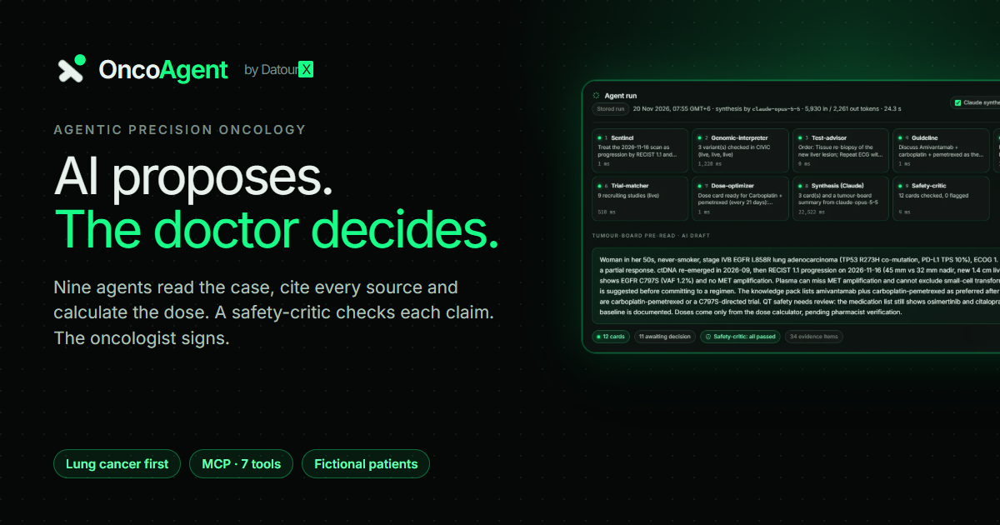

# OncoAgent

**Agentic decision support for oncologists. Nine agents read the case, cite every source and calculate the dose; a safety-critic checks each claim; the doctor decides.**

[](https://github.com/shahriyar9507/oncoagent/actions/workflows/ci.yml)
[](https://oncoagent.vercel.app)
[](docs/MCP.md)
[](LICENSE)


[**Live demo**](https://oncoagent.vercel.app) · [**Documentation**](docs/README.md) · [**Architecture**](docs/ARCHITECTURE.md) · [**MCP server**](docs/MCP.md) · [**Evaluation**](docs/EVALUATION.md) · [**Safety**](docs/SAFETY.md)

*Team DatourX · Idea to Unicorn, International AI Builders Congress 2026 · HealthSphere AI · PredictRx*

</div>

> [!IMPORTANT]
> OncoAgent is a research prototype for clinicians. It is **not a medical device** and not medical advice. **Every patient in this repository and in the live demo is fictional.**
>
> The live demo is for signed-in clinicians only. Judges receive the sign-in details with the submission.

---

## Why

A lung cancer patient progresses on her targeted drug. Before the next tumour board, her oncologist has to read a long molecular report, check the guideline options, look for interactions with her other medicines, search for recruiting trials and recalculate doses from her kidney function. All of it is done by hand, for every patient.

- About **20 million** people were diagnosed with cancer in 2022; **lung cancer caused 1.82 million deaths**, the most of any cancer (GLOBOCAN 2022).
- Bangladesh recorded **167,256** new cases with about **22 medical oncologists**: roughly **7,600 new patients per medical oncologist**, against about 137 in the United States (rough comparison; definitions differ). [Sources](docs/RESEARCH.md#11-without-ai-vs-with-ai--comparison-numbers-used-in-the-brief)
- Even in the US only about **45%** of NSCLC patients show evidence of biomarker testing before first-line therapy (JAMA Netw Open 2025).

Precision medicine exists. The bottleneck is the specialist time needed to apply it to each patient.

## What OncoAgent does

When a report lands, or when a clinician **enters a de-identified case and pastes its molecular report**, an orchestrator runs nine agents on the case and returns **recommendation cards**. Each card holds a proposal, the patient facts behind it, evidence IDs, confidence, uncertainty, alternatives and what would change the advice. The oncologist approves, modifies or rejects each card with a reason, and every decision is written to a **SHA-256 hash-chained audit log**.

| # | Agent | Job | Kind | Signs off |
|---|---|---|---|---|
| 1 | Sentinel | RECIST 1.1 response and ctDNA trend; red flags | code | Treating oncologist |
| 2 | Genomic-interpreter | Driver and resistance calls with **live CIViC** evidence | code | Molecular pathologist |
| 3 | Test-advisor | Missing guideline biomarkers and tests | code | Treating oncologist |
| 4 | Guideline | Ranked options from a curated, versioned knowledge pack | code | Tumour board |
| 5 | Pharmacology-safety | Interactions with current medicines (label rules) | code | Pharmacist |
| 6 | Trial-matcher | Recruiting trials from **ClinicalTrials.gov API v2** | code | Investigator |
| 7 | Dose-optimizer | Mosteller BSA, Cockcroft–Gault CrCl, Calvert carboplatin (GFR cap 125) | code | Pharmacist + oncologist |
| 8 | Synthesis | Tumour-board pre-read and up to three cards, citing only given evidence IDs | **Claude Opus 5.5** | Treating oncologist |
| 9 | Safety-critic | Flags unknown evidence, invented trials, stray doses, contraindicated or wrong-line drugs | code | — |

Eight of the nine agents are plain, testable code; only the synthesis step uses a model. **The model writes language, never numbers:** doses come from the calculator and trial IDs from the registry.

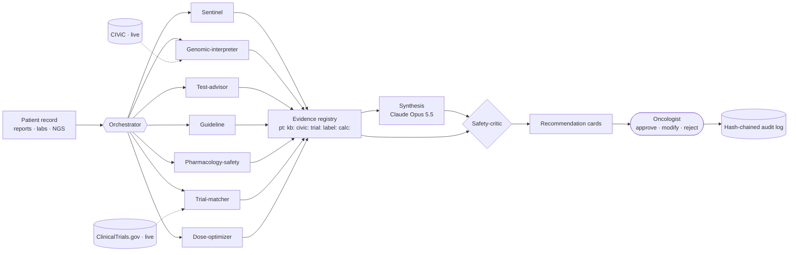

## Not just three demo patients

Open **[New case](https://oncoagent.vercel.app/cases/new)**, paste a molecular report and the same agents run on it:

- A **deterministic report reader** (no AI, runs in the browser) finds the alterations: EGFR exon 19 / exon 20 / point mutations, KRAS, BRAF, HER2, MET exon 14, ALK / ROS1 / RET / NTRK / NRG1 fusions. It also finds VAF, PD-L1 TPS, genes reported negative and the sample type. It shows the exact text behind each finding.
- A **setting selector** places the case in a curated knowledge pack of **20 entries**. The pack covers EGFR, ALK, ROS1, BRAF V600E, MET exon 14, RET, NTRK, KRAS G12C, HER2 and no-driver cases by PD-L1 and histology, plus second line, with **42 drugs, 34 regimens and 54 label-level interaction rules**. When no entry fits, it says so and proposes no treatment.
- Doses use Calvert, BSA, fixed, weight-band or per-kg rules from the labels.
- The case is stored per account in PostgreSQL when a database is connected, otherwise in the clinician's browser. The server validates and rebuilds it for each run. No names, record numbers or dates of birth are collected.

| | |
|---|---|
| 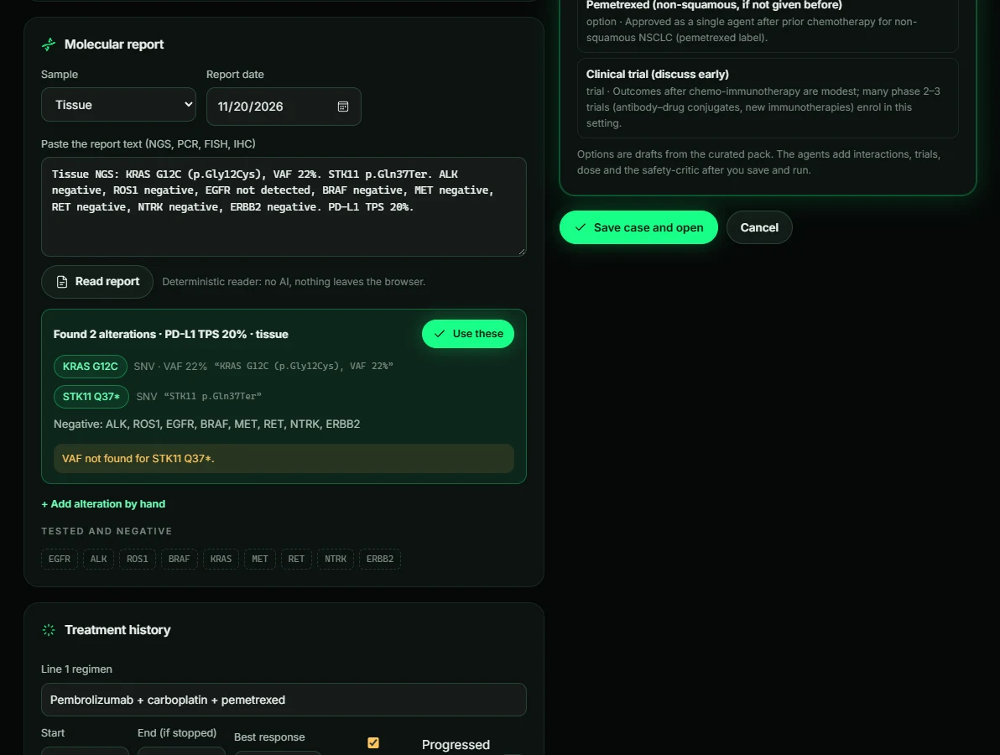 | 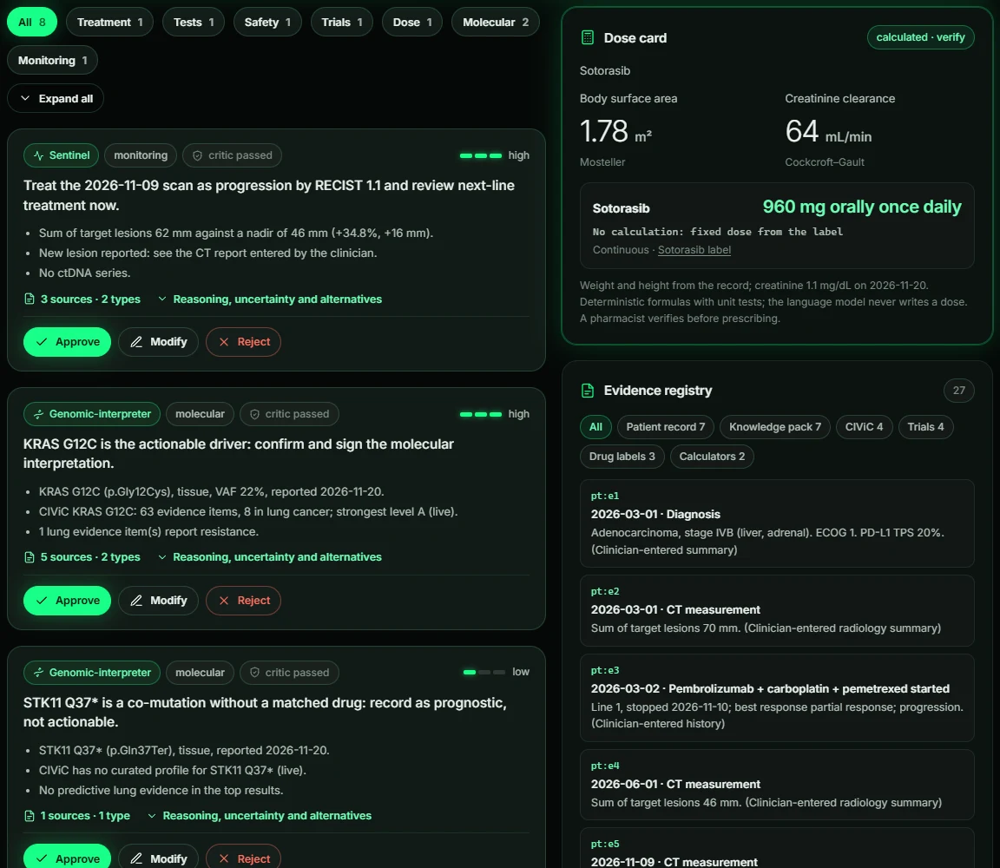 |
| **Case intake.** Paste the report; check what was found. | **Your case, analysed.** KRAS G12C after chemo-immunotherapy: sotorasib with an omeprazole warning. |

## See it

| | |
|---|---|
| 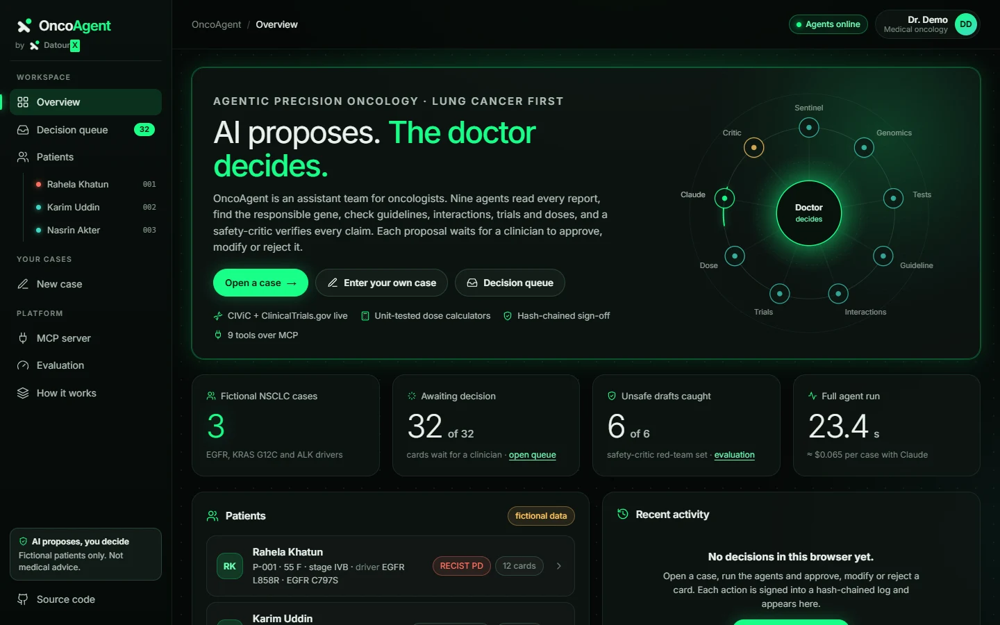 | 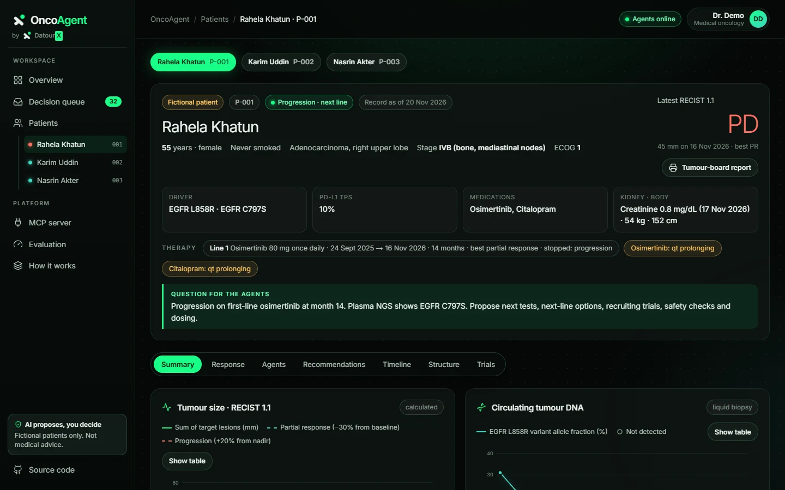 |
| **Overview.** Cases, pending decisions, live status. | **Patient record.** Summary, therapy lines, RECIST 1.1 and ctDNA charts. |
| 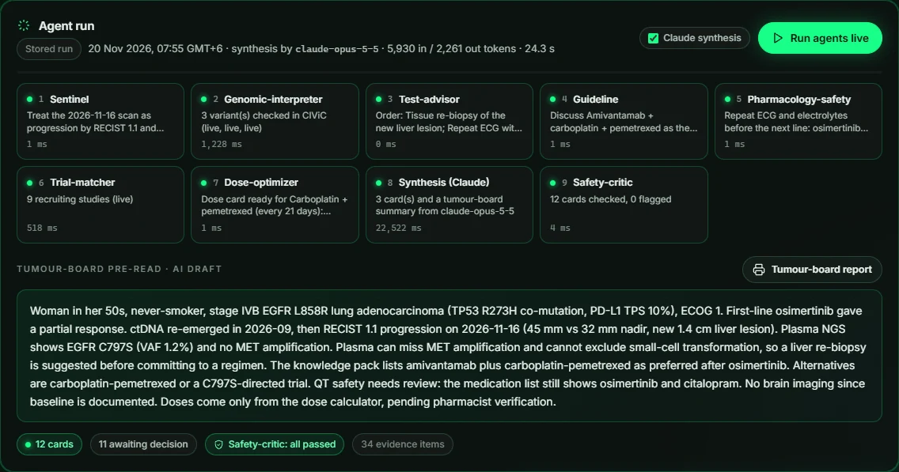 | 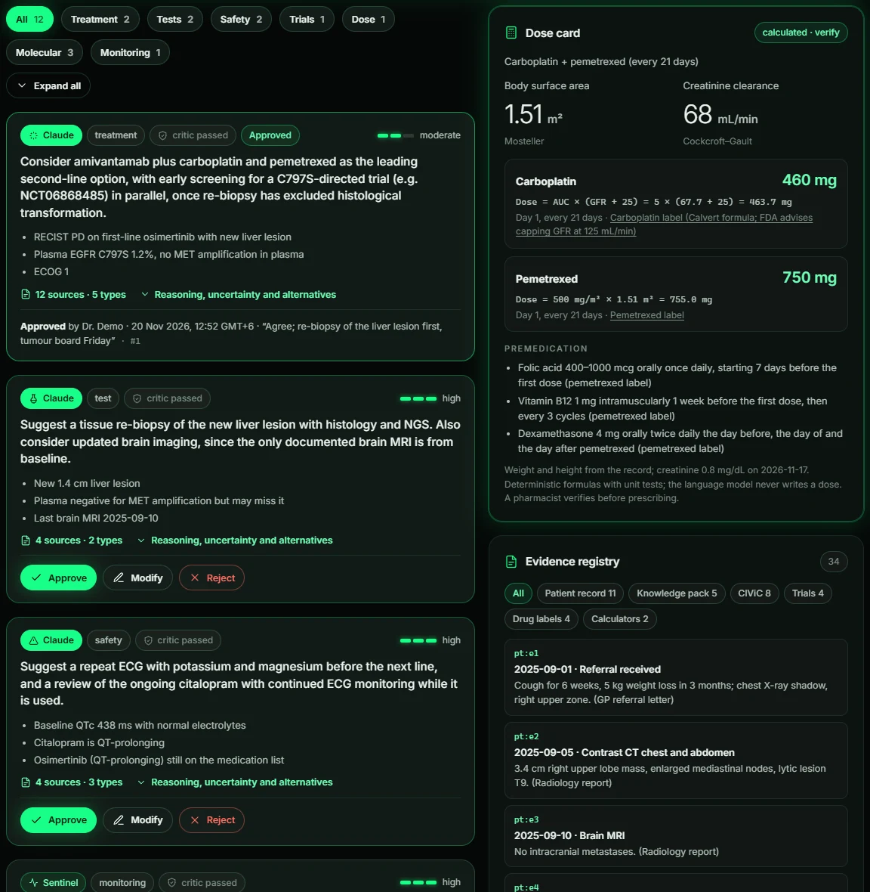 |
| **Agent run.** Nine steps streamed live, with the tumour-board pre-read. | **Cards and dose.** Evidence-backed proposals, calculated dose card. |
| 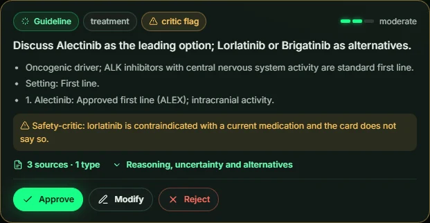 | 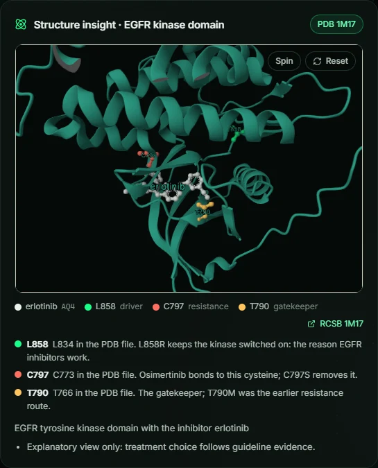 |
| **A real catch.** The critic flags lorlatinib while the patient takes carbamazepine. | **Structure insight.** Drug in its pocket; driver and resistance residues highlighted. |
| 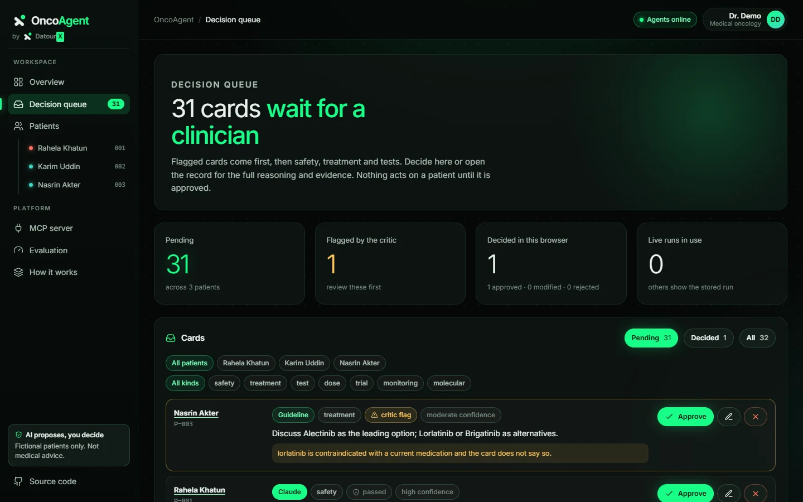 | 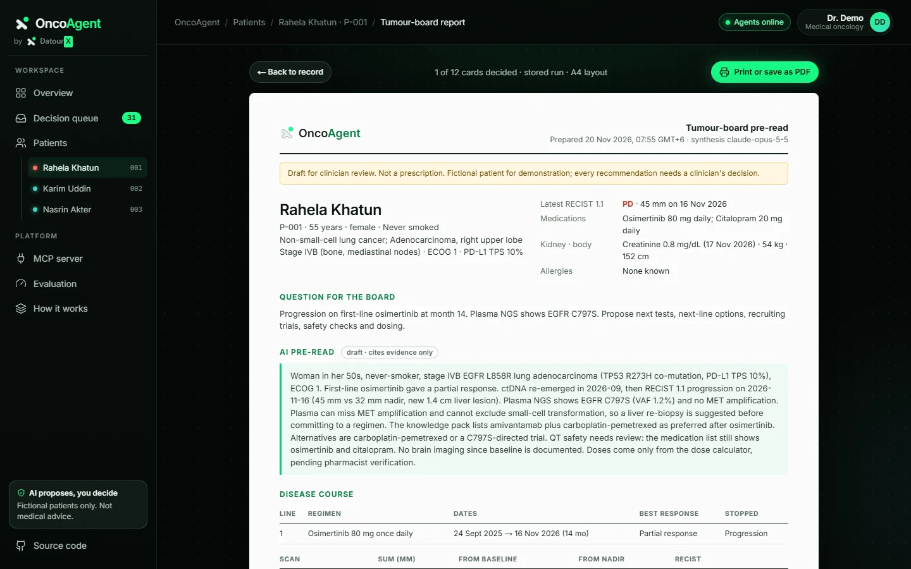 |
| **Decision queue.** Every pending card, flagged first, signed in place. | **Tumour-board report.** Printable A4 with decisions, dose and sources. |

More screens: [evidence drawer](docs/assets/screenshots/05-evidence-drawer.webp) · [sign-off dialog](docs/assets/screenshots/06-sign-off-dialog.webp) · [MCP tester](docs/assets/screenshots/11-mcp-playground.webp) · [evaluation](docs/assets/screenshots/12-evaluation.webp) · [phone](docs/assets/screenshots/15-mobile.webp)

## Results

Measured by [`app/scripts/eval.ts`](app/scripts/eval.ts) on the stored runs; method in [docs/EVALUATION.md](docs/EVALUATION.md).

| Measure | Result |
|---|---|
| Driver alteration identified | **3/3** cases |
| Leading option matches the gold answer | **3/3** (Claude) · 3/3 (rules) |
| Citations that resolve to evidence in the run | **100%** |
| Trial IDs returned by the registry | **100%** |
| Doses exactly as hand-calculated | **3/3**; **186** unit tests (dosing, RECIST, setting selection, report reader, sign-in and storage) |
| Doses written outside the calculator · unsafe leading options | **0 · 0** |
| Adversarial unsafe drafts caught by the critic | **6/6** |
| Full run with Claude | **≈ 23 s** · **≈ US$0.065** per case |

Three fictional gold cases cannot support clinical accuracy claims. A pilot needs hundreds of de-identified cases with tumour-board answers, under ethics approval.

## Safety by design

1. **AI proposes, a clinician decides.** No agent can sign, prescribe, order or contact a patient. `record_decision` over MCP refuses without a clinician token.
2. **Nothing from model memory.** Every drug, dose, trial ID and citation must exist in the run's evidence registry; the critic flags anything else.
3. **Doses from code.** Unit-tested calculators; a creatinine older than 7 days or a clearance below the label limit blocks the dose card.
4. **De-identified model input.** Claude sees a pseudonymous ID and an age band, never a name.
5. **Documents are data.** Text inside reports and tool outputs is never treated as instructions.
6. **Research stays research.** The level-3 molecule track is a partner pipeline and never writes to a patient record.

Details, hazards and the regulatory position: [docs/SAFETY.md](docs/SAFETY.md).

## Production foundations

| | |
|---|---|
| **Sign-in** | Every page and API needs a clinician session: signed `httpOnly` cookie, scrypt password hashes kept only in the environment, lockout after repeated wrong passwords, one switch to sign everyone out |
| **Signed decisions** | The audit entry's signer is the session user, set on the server; a name sent by the browser is ignored |
| **Server storage** | Set `DATABASE_URL` and cases, runs and the audit log are kept in PostgreSQL per account. The audit table is append-only, enforced by a database trigger, and SHA-256 chained. Without a database the app keeps data in the browser and says so |
| **Hardening** | Content Security Policy, HSTS, cross-site request guard, no-store API answers, MCP behind a bearer token or session |
| **Operations** | `/api/health` for uptime monitors (version, sign-in, storage, evidence sources), `npm run smoke` against any deployment, `npm run db:migrate`, CI on every push |

Set-up and key rotation: [docs/DEPLOYMENT.md](docs/DEPLOYMENT.md). Security model: [SECURITY.md](SECURITY.md).

## Quick start

Requires Node.js 20.9 or newer.

```bash
git clone https://github.com/shahriyar9507/oncoagent.git
cd oncoagent/app
npm install
npm run dev                 # http://localhost:3000
```

Sign-in is on by default, so create an account first:

```bash
cp .env.example .env.local
npm run hash-password -- "<choose a password>" --secret
# copy the printed AUTH_SECRET and AUTH_PASSWORD_HASH into .env.local (escape each $ as \$),
# then set AUTH_USERNAME; optionally ANTHROPIC_API_KEY and DATABASE_URL
```

Without an API key the agents run **rules-only**. Without `DATABASE_URL` data stays in the browser. Details: [docs/DEPLOYMENT.md](docs/DEPLOYMENT.md#2-local-development).

| Script | What it does |
|---|---|
| `npm test` | 186 unit tests: dosing, RECIST, setting selection, report reader, sign-in, sessions, storage and API routes (Vitest) |
| `npm run typecheck` · `npm run lint` | TypeScript and ESLint |
| `npm run eval` | Gold-case and adversarial evaluation on stored runs |
| `npm run precompute` | Re-run all cases with Claude and store snapshots |
| `npm run snapshot` | Refresh the offline CIViC and trial snapshots |
| `npm run mcp:stdio` · `npm run mcp:smoke` | Serve or smoke-test the MCP server over stdio |
| `npm run hash-password` · `npm run db:migrate` | Create a password hash and session secret · create the storage tables |
| `npm run smoke -- <url>` | Ten checks against a running deployment, including sign-in and a rules-only run |

Environment variables (all listed in [app/.env.example](app/.env.example)) and deployment: [docs/DEPLOYMENT.md](docs/DEPLOYMENT.md).

## Use the tools from any MCP client

```bash
claude mcp add --transport http oncoagent https://oncoagent.vercel.app/api/mcp   --header "Authorization: Bearer <token>"
```

Nine tools: `list_patients` · `get_case_timeline` · `interpret_variant` (CIViC) · `search_trials` (ClinicalTrials.gov) · `calculate_dose` · `draft_recommendations` · `extract_report` · `analyze_case` · `record_decision`. One definition serves stdio and Streamable HTTP. Signed-in clinicians can also call them from the browser on the [MCP page](https://oncoagent.vercel.app/mcp), without a token. Reference: [docs/MCP.md](docs/MCP.md).

## Repository map

```text
oncoagent/
├── app/                        Next.js 16 clinician workspace, agents and MCP server
│   ├── src/app/                Routes: sign-in, overview, patients, cases (new, record, report), queue, mcp, evaluation, architecture, API
│   ├── src/components/         Workspace UI: case form, patient record, agent run, cards, drawer, charts, Mol* viewer, queue, report
│   ├── src/lib/agents/         Orchestrator, rule agents, Claude synthesis, safety-critic
│   ├── src/lib/clinical/       Dose calculators, RECIST 1.1, setting selector, report reader (+ 156 unit tests)
│   ├── src/lib/server/         Accounts, passwords, PostgreSQL store, append-only audit (+ 19 tests)
│   ├── src/proxy.ts            Sign-in gate and cross-site guard in front of every page and API
│   ├── src/lib/tools/          CIViC and ClinicalTrials.gov clients with snapshot fallback
│   ├── src/lib/mcp/            oncoagent-mcp tool definitions
│   ├── src/lib/data/           Fictional cases, knowledge pack (20 entries), regimens, medications, structures, stored runs
│   ├── mcp/stdio.ts            MCP server over stdio
│   └── scripts/                eval, precompute, snapshot, mcp-smoke, smoke, db-migrate, hash-password
├── docs/                       Architecture, agents, MCP, API, evaluation, safety, data, design, deployment, roadmap
│   ├── submission/             Competition book, pitch deck, video script, fact sheet
│   └── brief/                  Project brief in Bangla
├── .claude/                    25 project sub-agents and 13 skills used to build OncoAgent
└── .github/                    CI, issue forms, PR template
```

## Submission materials

| Material | Interactive | PDF |
|---|---|---|
| Submission book (54 pages, copy-ready portal answers) | [book.html](docs/submission/book.html) | [PDF](docs/submission/pdf/OncoAgent-Submission-Book.pdf) |
| Pitch deck (20 slides, animated, speaker notes on **N**) | [deck.html](docs/submission/deck.html) | [PDF](docs/submission/pdf/OncoAgent-Pitch-Deck.pdf) |
| Project brief in Bangla | [index.html](docs/brief/index.html) | [PDF](docs/submission/pdf/OncoAgent-Brief-Bangla.pdf) |
| Tumour-board reports (fictional P-001 to P-003) | [live](https://oncoagent.vercel.app/patients/P-001/report) | [P-001](docs/submission/pdf/OncoAgent-Tumour-Board-Report-P-001.pdf) · [P-002](docs/submission/pdf/OncoAgent-Tumour-Board-Report-P-002.pdf) · [P-003](docs/submission/pdf/OncoAgent-Tumour-Board-Report-P-003.pdf) |
| Video script and production plan | [video-script.md](docs/submission/video-script.md) | — |
| Fact sheet (every public number and its source) | [fact-sheet.md](docs/submission/fact-sheet.md) | — |

## Documentation

| Read | For |
|---|---|
| [docs/ARCHITECTURE.md](docs/ARCHITECTURE.md) | System context, run sequence, modules, decisions, target architecture |
| [docs/AGENTS.md](docs/AGENTS.md) | Each agent's inputs, outputs, autonomy and failure modes; the card schema |
| [docs/MCP.md](docs/MCP.md) · [docs/API.md](docs/API.md) | Tool and HTTP reference with examples |
| [docs/EVALUATION.md](docs/EVALUATION.md) | Metrics, adversarial set, results, pilot plan |
| [docs/SAFETY.md](docs/SAFETY.md) | Intended use, hazards and controls, regulation |
| [docs/DATA.md](docs/DATA.md) | Data model, fictional cases, provenance, privacy |
| [docs/DESIGN.md](docs/DESIGN.md) | Design system and accessibility |
| [docs/DEPLOYMENT.md](docs/DEPLOYMENT.md) · [docs/ROADMAP.md](docs/ROADMAP.md) | Running it, and what comes next |
| [docs/RESEARCH.md](docs/RESEARCH.md) | Research base with sources |

## Stack

Next.js 16 (App Router, TypeScript strict) · plain-CSS design system and hand-built SVG charts · Anthropic TypeScript SDK with structured outputs (`claude-opus-5-5`) · MCP SDK v2 + `mcp-handler` · Mol* 4.18 with MolViewSpec · Vitest · Vercel.

## Roadmap

| Months | Phase | Exit criteria |
|---|---|---|
| 0–2 | Foundation | Server-side cases, audit and runs; sign-in; hazard log; regulatory classification |
| 2–8 | NSCLC product | PDF upload on top of the text reader, guideline RAG, ≥ 90% gold-case concordance |
| 8–14 | Pilot + breast | Ethics approval, hospital integration, silent-mode study on real cases |
| 14–30 | Scale + research | Live pilot, colorectal, research zone with a licensed discovery partner |

Full plan: [docs/ROADMAP.md](docs/ROADMAP.md).

## How it was built

With [Claude Code](https://claude.com/claude-code), a team of 25 project sub-agents (oncology, molecular pathology, pharmacology, bioinformatics, structural biology, AI engineering, design, regulation and clinical safety) and 13 project skills, all in [`.claude/`](.claude). Every number in the public documents traces to [docs/submission/fact-sheet.md](docs/submission/fact-sheet.md) or [docs/RESEARCH.md](docs/RESEARCH.md).

## Contributing, security, licence

[CONTRIBUTING.md](CONTRIBUTING.md) · [SECURITY.md](SECURITY.md) · [CODE_OF_CONDUCT.md](CODE_OF_CONDUCT.md) · [CHANGELOG.md](CHANGELOG.md) · [CITATION.cff](CITATION.cff) · code under the [MIT licence](LICENSE).

<div align="center"><sub>Team DatourX · AI proposes. The doctor decides. · AI প্রস্তাব দেয়, ডাক্তার সিদ্ধান্ত নেন।</sub></div>
