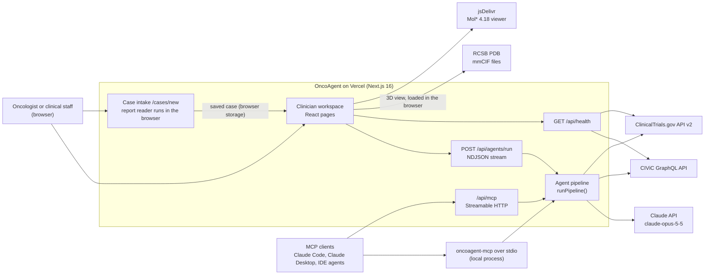
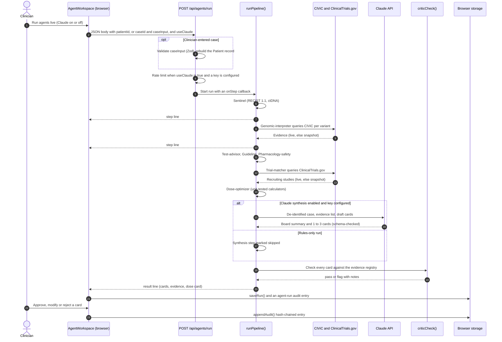
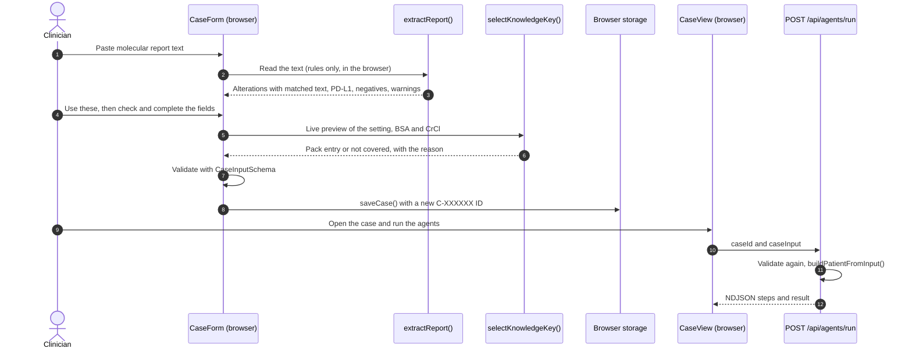
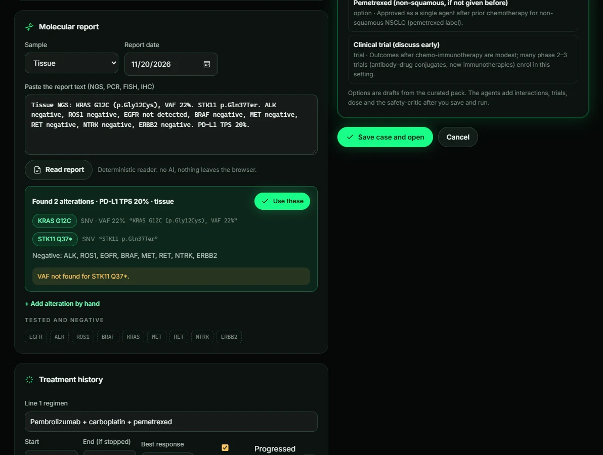
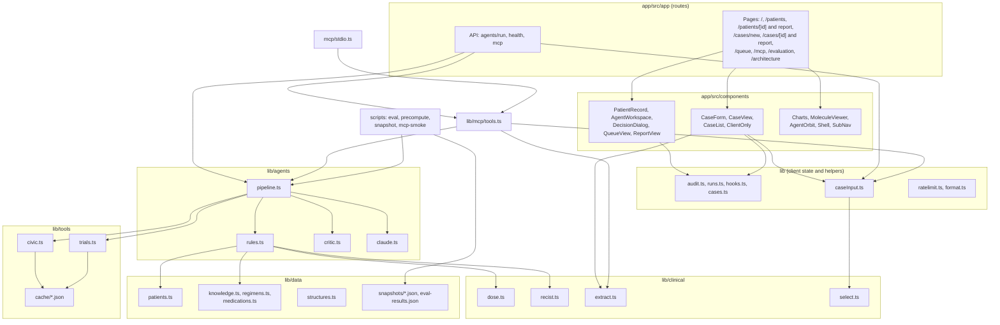
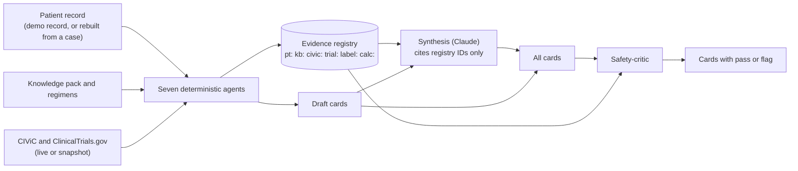
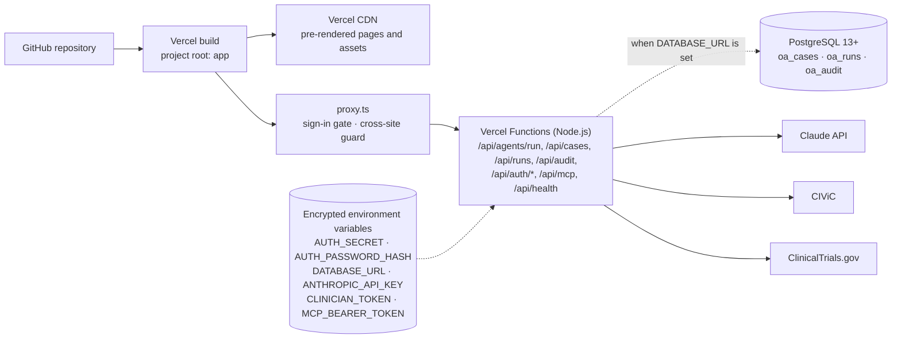

# Architecture

OncoAgent, team DatourX. Version 0.3, 20 November 2026 (describes app v0.3.0).

This document has two halves:

- **[As built (MVP)](#2-as-built-mvp)** describes the code in [`app/`](../app) today. Every statement there can be checked against a file linked next to it.
- **[Target (production)](#3-target-production)** describes the platform we intend to build. Nothing in that half is implemented unless the [as-built half](#2-as-built-mvp) says so.

Evidence behind the design choices is in [RESEARCH.md](RESEARCH.md). The phased plan is in [ROADMAP.md](ROADMAP.md).

> The demo patients in this repository are fictional, and cases entered through the intake form must be de-identified or fictional. OncoAgent is a research prototype for oncologists and clinical staff. It is not a medical device and it gives no advice to patients.

## 1. Purpose and scope

OncoAgent is a decision-support workspace for oncologists. For each new event in a patient's record a team of agents proposes the next test, interprets the molecular result, lists guideline options, checks interactions, finds recruiting trials and calculates doses. Every proposal is a recommendation card with its evidence, and a clinician approves, modifies or rejects it.

- **Users:** oncologists and clinical staff only. There is no patient app and no patient-facing message.
- **First cancer:** non-small-cell lung cancer (NSCLC), then breast, then colorectal. Cancer-specific content lives in data files (knowledge pack, regimens, panels); the agent code is cancer-agnostic.
- **Two tracks:** the clinical track (approved drugs, guidelines, registered trials) and a research track (de-identified cohorts, target dossiers, partner discovery). The research track is not built; when it is, its outputs never enter a patient's chart.

### Status at a glance

| Concern | As built (MVP) | Target (production) |
|---|---|---|
| Patient data | 3 fictional NSCLC records in TypeScript ([patients.ts](../app/src/lib/data/patients.ts)), plus de-identified cases entered by clinicians and kept in the browser | FHIR R4 + mCODE from hospital systems, de-identified research mart |
| Data entry | Case intake form; pasted report text read by a deterministic reader in the browser; the server validates each case (Zod) and rebuilds the record per run | FHIR ingestion, lab and PDF report feeds, clinician confirmation of extracted fields |
| Agents | 9 agents in one in-process pipeline ([pipeline.ts](../app/src/lib/agents/pipeline.ts)) | Durable workflow orchestrator, more agents (imaging, pathology, report-writer) |
| Language model | Claude Opus 5.5 for synthesis only, structured output | Same rule (model writes language, not numbers) behind a de-identification gateway |
| Evidence | CIViC and ClinicalTrials.gov live with committed snapshots; curated knowledge pack of 20 settings, 34 regimens, 54 interaction rules | Licensed knowledge bases, versioned guideline retrieval |
| Clinician decision | Approve / modify / reject with reason (acknowledgement and reason to approve a flagged card), SHA-256 hash chain in the browser | Same flow with SSO identity, e-signature and an append-only server table |
| Interfaces | Web workspace, NDJSON run API, MCP server with nine tools (stdio and HTTP) | Plus FHIR / CDS Hooks into the EHR |
| Hosting | Vercel (Next.js functions), no database | In-country hosting option, Kubernetes, managed database |

## 2. As built (MVP)

### 2.1 System context



- The browser never calls Claude, CIViC or ClinicalTrials.gov for agent work; the server does. The API key stays on the server ([claude.ts](../app/src/lib/agents/claude.ts)).
- The 3D structure view is the exception: the browser loads Mol* from jsDelivr and the structure file from RCSB PDB directly ([MoleculeViewer.tsx](../app/src/components/MoleculeViewer.tsx)).
- Case intake runs in the browser: the report reader, the setting preview and the case store. Pasted report text never leaves the browser; a saved case is sent to the server only as a validated `caseInput` with each run.
- The stdio MCP server runs the same pipeline in a local process ([mcp/stdio.ts](../app/mcp/stdio.ts)).

### 2.2 One agent run, end to end



Notes on the sequence:

1. Each agent runs inside a `step()` wrapper in [pipeline.ts](../app/src/lib/agents/pipeline.ts). An exception inside an agent becomes a step with `status: "error"` and a warning; the run continues with the other agents.
2. The route streams one JSON object per line ([route.ts](../app/src/app/api/agents/run/route.ts)): `step` events as agents finish, then one `result`, or one `error` if the pipeline itself fails. Details in [API.md](API.md).
3. Claude's cards are placed before the rules cards. The safety-critic then checks all cards, including Claude's.
4. The live run and the audit log are kept in the browser in the MVP (section 2.6). For an entered case the server keeps nothing after the response.

### 2.3 Case intake

Since v0.3 a clinician can enter a de-identified NSCLC case and run the same agents on it. Details: [DATA.md](DATA.md#3-clinician-entered-cases).



- One Zod schema (`CaseInputSchema` in [caseInput.ts](../app/src/lib/caseInput.ts)) validates the form, the run API and the MCP `analyze_case` tool. The server never accepts a client-built record.
- `buildPatientFromInput()` is deterministic and turns every entered fact into a timeline event, so the agents can cite it as `pt:` evidence.
- The setting selector ([select.ts](../app/src/lib/clinical/select.ts)) picks the knowledge-pack entry from the driver, the line of therapy, PD-L1 and histology. When no entry fits it returns none, and the agents propose no treatment.
- The report reader ([extract.ts](../app/src/lib/clinical/extract.ts)) uses regular expressions only; each finding carries the text it came from, and the clinician confirms it.



### 2.4 Module map



| Path | Responsibility | Key exports |
|---|---|---|
| [lib/types.ts](../app/src/lib/types.ts) | Domain types | `Patient`, `RecommendationCard`, `EvidenceItem`, `AgentRunResult`, `AuditEntry` |
| [lib/agents/pipeline.ts](../app/src/lib/agents/pipeline.ts) | Orchestrator: runs the nine agents in order | `runPipeline`, `PipelineResult` |
| [lib/agents/rules.ts](../app/src/lib/agents/rules.ts) | Seven deterministic agents and the evidence registry | `EvidenceRegistry`, `sentinel`, `genomicInterpreter`, `testAdvisor`, `guideline`, `pharmacologySafety`, `trialMatcher`, `doseOptimizer` |
| [lib/agents/claude.ts](../app/src/lib/agents/claude.ts) | Synthesis agent (Claude, structured output) | `synthesise`, `hasClaude`, `MODEL` |
| [lib/agents/critic.ts](../app/src/lib/agents/critic.ts) | Safety-critic | `criticCheck` |
| [lib/clinical/dose.ts](../app/src/lib/clinical/dose.ts) | Mosteller BSA, Cockcroft–Gault, Calvert, per-kg and weight-band dosing, dose card | `buildDoseCard`, `perKgDose`, `pickWeightBand`, `GFR_CAP`, `CREATININE_MAX_AGE_DAYS` |
| [lib/clinical/recist.ts](../app/src/lib/clinical/recist.ts) | RECIST 1.1 categories from target-lesion sums | `assessRecist`, `bestResponse` |
| [lib/clinical/extract.ts](../app/src/lib/clinical/extract.ts) | Deterministic molecular-report reader | `extractReport`, `normaliseGene`, `threeToOne` |
| [lib/clinical/select.ts](../app/src/lib/clinical/select.ts) | Knowledge-pack setting selector for entered cases | `selectKnowledgeKey` |
| [lib/caseInput.ts](../app/src/lib/caseInput.ts) | Case schema and record builder, shared by browser, API and MCP | `CaseInputSchema`, `buildPatientFromInput`, `newCaseId`, `CASE_ID_PATTERN` |
| [lib/cases.ts](../app/src/lib/cases.ts) | Browser storage of entered cases | `saveCase`, `getCase`, `deleteCase`, `useCases`, `useCase` |
| [lib/tools/civic.ts](../app/src/lib/tools/civic.ts) | CIViC GraphQL client with snapshot fallback | `interpretVariant`, `fetchCivicRaw` |
| [lib/tools/trials.ts](../app/src/lib/tools/trials.ts) | ClinicalTrials.gov v2 client with snapshot fallback | `searchTrials`, `fetchTrialsRaw` |
| [lib/data/](../app/src/lib/data) | Fictional patients, knowledge pack (20 entries), regimens (34), medication catalogue (59), PDB structures, stored runs, eval results | `patients`, `knowledge`, `interactionRules`, `regimens`, `MEDICATION_CATALOGUE`, `tagsFor`, `structures`, `structureForVariants` |
| [lib/mcp/tools.ts](../app/src/lib/mcp/tools.ts) | The nine MCP tools, shared by both transports | `registerOncoTools`, `SERVER_INFO` |
| [lib/audit.ts](../app/src/lib/audit.ts), [lib/runs.ts](../app/src/lib/runs.ts), [lib/hooks.ts](../app/src/lib/hooks.ts) | Browser-side audit chain and live-run storage | `appendAudit`, `verifyAudit`, `saveRun`, `useAudit`, `useStoredRun` |
| [lib/ratelimit.ts](../app/src/lib/ratelimit.ts) | In-memory sliding-window limiter | `allow`, `CLAUDE_RUNS_PER_IP`, `MCP_CLAUDE_RUNS_PER_HOUR` |
| [components/](../app/src/components) | UI components (see [DESIGN.md](DESIGN.md)) | `PatientRecord`, `AgentWorkspace`, `DecisionDialog`, `QueueView`, `ReportView`, `CaseForm`, `CaseView`, `CaseList`, `ClientOnly`, `Charts`, `MoleculeViewer` |
| [scripts/](../app/scripts) | Evaluation, stored-run generation, snapshot refresh, MCP smoke test | see [DEPLOYMENT.md](DEPLOYMENT.md) |

### 2.5 Data flow and the evidence registry

Every fact an agent uses is registered once in an `EvidenceRegistry` ([rules.ts](../app/src/lib/agents/rules.ts)) under a typed ID. Cards cite these IDs. The synthesis agent receives the registry as its `EVIDENCE` list and may cite only those IDs; the safety-critic flags any ID that is not in the registry.

| Prefix | Kind | Created by | Example | Content |
|---|---|---|---|---|
| `pt:` | `patient` | `patientEvidence()` | `pt:e5` | One timeline event: date, title, detail, source document |
| `kb:` | `guideline` | `guideline()`, `testAdvisor()` | `kb:alk1-alectinib`, `kb:ALK_1L:test0` | A knowledge-pack option or test, with basis and pack version |
| `civic:` | `civic` | `genomicInterpreter()` | `civic:EID964` | A CIViC evidence item: level, significance, disease, therapies, PMID, URL |
| `trial:` | `trial` | `trialMatcher()` | `trial:NCT05256290` | A recruiting study from ClinicalTrials.gov: phase, status, sponsor, countries, URL |
| `label:` | `label` | `guideline()`, `pharmacologySafety()`, `doseOptimizer()` | `label:lorlatinib:strong-cyp3a-inducer:0`, `label:brigatinib:strong-cyp3a-inducer:g1`, `label:dose:0:carboplatin` | A product-label rule or dose parameter, with a DailyMed link |
| `calc:` | `calculator` | `sentinel()`, `doseOptimizer()` | `calc:recist`, `calc:dose` | A deterministic calculation with its inputs and result |



### 2.6 State: where data lives

Since v0.4 the app has two storage modes, chosen at build time by `DATABASE_URL`. **Server mode** keeps entered cases, live runs and the audit log in PostgreSQL, one set of rows per signed-in account ([store.ts](../app/src/lib/server/store.ts), tables `oa_cases`, `oa_runs`, `oa_audit`, `oa_meta`). **Browser mode** keeps them in `localStorage`, as before. The same client modules ([cases.ts](../app/src/lib/cases.ts), [runs.ts](../app/src/lib/runs.ts), [audit.ts](../app/src/lib/audit.ts)) serve both modes; the account menu shows which one is active. The public demo currently runs in browser mode.

| Data | MVP location | Lifetime | Production (planned) |
|---|---|---|---|
| Accounts | Environment variables (`AUTH_USERNAME` + `AUTH_PASSWORD_HASH`, or `AUTH_USERS`), scrypt hashes only ([users.ts](../app/src/lib/server/users.ts)) | Until the variables change | Hospital SSO (OIDC, MFA) |
| Sessions | Signed `oa_session` cookie (HS256, 12 h) in the clinician's browser ([session.ts](../app/src/lib/session.ts)) | 12 hours, sign-out, or a change of `AUTH_SECRET` / `AUTH_SESSION_VERSION` | SSO session |
| Demo patient records | [patients.ts](../app/src/lib/data/patients.ts), in the bundle | Until the code changes | FHIR server (mCODE) |
| Clinician-entered cases | Server mode: `oa_cases`, per account. Browser mode: `localStorage`, key `oncoagent.cases.v1`. Either way rebuilt in server memory for each run | Until deleted (or browser storage is cleared) | The hospital's own PostgreSQL inside its network |
| Knowledge pack, regimens, structures | [lib/data/](../app/src/lib/data), version `nsclc-pack 2026-11-20` | Until the code changes | Versioned knowledge service with review workflow |
| CIViC and trial snapshots | [lib/tools/cache/](../app/src/lib/tools/cache), written by `npm run snapshot` | Until refreshed and committed | Scheduled refresh with a stored fetch date |
| Stored agent runs | [lib/data/snapshots/P-00x.json](../app/src/lib/data/snapshots), written by `npm run precompute` | Until regenerated | Server-side run store |
| Live agent run (latest per patient or case) | Server mode: `oa_runs`, written by `/api/agents/run` itself. Browser mode: `localStorage`, key `oncoagent.run.v1.<id>` | Until replaced, "Stored run" is pressed or the case is deleted | Run store linked to the audit log, with retention rules |
| Audit log (decisions and live runs) | Server mode: `oa_audit`, append-only (a trigger refuses `UPDATE` and `DELETE`), SHA-256 chained per account under an advisory lock; signer taken from the session. Browser mode: `localStorage`, key `oncoagent.audit.v1` | Permanent (server) · until storage is cleared (browser) | Same table, plus backups and signed exports |
| MCP `record_decision` chain | Server memory, per function instance ([tools.ts](../app/src/lib/mcp/tools.ts)) | Until the instance is recycled | Same append-only table as the web app |
| Rate-limit counters | Server memory, per function instance ([ratelimit.ts](../app/src/lib/ratelimit.ts)) | Until the instance is recycled | Shared store with per-clinician quotas |

For the demo patients the UI shows the stored run first, so every page renders instantly and the evaluation is reproducible. Entered cases have no stored run until the clinician runs the agents. A clinician can start a live run at any time; the newest live run then replaces the stored run in that browser.

### 2.7 Deployment topology



- One Next.js 16 app serves the pages and the API routes. Patient pages are pre-rendered for the three fictional records (`generateStaticParams`); `/mcp` renders per request because it reads the host header to show the endpoint URL; `/cases/*` pages render in the browser because the case comes from the storage API or browser storage (`ClientOnly`, `useCase`). [proxy.ts](../app/src/proxy.ts) runs before every page and API route: without a valid session, pages redirect to `/login` and API routes answer 401; route handlers verify the session again before touching data.
- `/api/agents/run` and `/api/mcp` set `maxDuration = 300` seconds. A run with Claude takes about 23 s ([EVALUATION.md](EVALUATION.md)).
- [next.config.ts](../app/next.config.ts) removes the `X-Powered-By` header and adds a Content Security Policy, `Strict-Transport-Security`, `Cross-Origin-Opener-Policy`, `Permissions-Policy`, `X-Content-Type-Options: nosniff`, `Referrer-Policy: strict-origin-when-cross-origin` and `X-Frame-Options: SAMEORIGIN` to every response, and `Cache-Control: no-store` to API answers.
- Sign-in needs `AUTH_SECRET` and one account. Everything else is optional: without `ANTHROPIC_API_KEY` the agents run rules-only and the top bar says so; without `DATABASE_URL` data stays in the browser. Setup, scripts and key rotation: [DEPLOYMENT.md](DEPLOYMENT.md).

### 2.8 Key decisions

| # | Decision | Why | Trade-off |
|---|---|---|---|
| 1 | Eight of nine agents are deterministic code; the model writes language only | Doses, trial IDs and interaction verdicts must be testable and repeatable | Rules must be curated per cancer type; less flexible than free reasoning |
| 2 | Typed evidence registry; cards cite IDs; the model may cite only given IDs | Citations can be checked mechanically and opened by the clinician | The model cannot bring in literature that no tool retrieved |
| 3 | Deterministic safety-critic after synthesis, which flags rather than deletes | The clinician sees what was wrong and why; the checks are unit-testable | String matching can miss unsafe phrasing; approving a flagged card needs an acknowledgement and a reason, not a second person |
| 4 | Structured output validated against a Zod schema (`messages.parse`) | No free-text parsing; the model cannot emit `dose`, `trial` or `summary` cards | Schema changes need a code change and a re-run of the evaluation |
| 5 | Live CIViC and ClinicalTrials.gov with committed snapshots as fallback | A source outage never leaves a card empty; the evaluation is reproducible | Snapshots age; the cache files do not record their fetch date |
| 6 | Stored runs shown first, live runs on demand | Instant pages, controlled model cost, same data for judges and the evaluation | The run on screen can be older than the live sources |
| 7 | Audit log and live runs in PostgreSQL when `DATABASE_URL` is set, else in the browser | One code path for a zero-operations demo and a real deployment; the database enforces append-only | Browser mode is not shared and can be rebuilt by the browser owner; the mode is fixed at build time, so changing it needs a redeploy |
| 8 | NDJSON stream over one POST | Per-agent progress with plain `fetch`; works in serverless functions | No resume after a dropped connection |
| 9 | One MCP tool definition for stdio and Streamable HTTP | The two transports cannot drift apart | Decision chain and rate limits are per process or instance |
| 10 | One Next.js app, plain CSS, hand-built SVG charts | One deployable; full control of accessibility and of the visual system | Heavy services (FHIR, workflows, imaging) move out in production |
| 11 | Pinned model ID `claude-opus-5-5`, effort `medium`, server-side refusal fallback | Reproducible behaviour, bounded latency and cost, synthesis survives a refusal | A fallback model may answer; the run records `response.model` |
| 12 | In-memory rate limits (a sliding window of timestamps per key), counted only for real Claude runs | Caps model spend on a public demo without extra infrastructure | Per instance, resets on cold start, keyed by IP |
| 13 | Fictional records frozen at an `asOf` date (2026-11-20) | Freshness rules (creatinine age) give the same result on any day | Entered cases carry the save date as `asOf`; real records must use the current date |
| 14 | One Zod schema for entered cases in the browser, the API and MCP; the server rebuilds the record | One definition of a valid case; a client cannot inject a crafted record | Schema changes touch all three surfaces at once |
| 15 | Deterministic report reader with regular expressions, run in the browser | No report text leaves the browser; every finding shows its source text; testable (81 tests) | Unusual phrasing is missed or becomes a warning; no PDF or image input yet |
| 16 | Deterministic setting selector; uncovered settings return no entry | The agents never guess a treatment outside the curated pack, and the reason is shown | Many real settings (later lines, uncommon mutations) end in "discuss at tumour board" until the pack grows |
| 17 | Entered cases stored per account (server mode) or per browser | Rows are filtered by owner in every query; the same Zod schema validates both paths | Cases are not shared between accounts yet; team sharing needs roles |
| 18 | Accounts and passwords from the environment, signed cookie sessions (no session table) | No credential in the repository; works on serverless with no extra service | No self-service password change; revoking one session needs a global sign-out (`AUTH_SESSION_VERSION`); SSO replaces it |
| 19 | One gate (`proxy.ts`) plus a session check in each route handler | A missed matcher cannot expose data; pages and APIs share one rule | Two places to keep in step; tests cover both |

## 3. Target (production)

Status: design for review. Nothing in this section is implemented unless section 2 says so.

### 3.1 Design principles

1. Human in the loop at every clinical gate. Autonomy levels A0 to A3 are allowed; A4 (acting without a clinician) is forbidden.
2. Tools, not memory: every drug, dose, trial and citation is fetched and cited.
3. Explain or do not show: every proposal is a recommendation card with reason, evidence, confidence and uncertainty.
4. Privacy by design, with in-country data residency where the law requires it.
5. Evaluation before deployment, monitoring after.
6. Standards-first data: FHIR R4 with mCODE, HL7 Genomics Reporting, OMOP, DICOM.
7. Clean licences: AlphaFold 3 weights are non-commercial; OncoKB needs a commercial licence; NCCN content has redistribution limits.

Principles 1 to 3 and 5 are already enforced in the MVP (sections 2.2 to 2.4 and [EVALUATION.md](EVALUATION.md)).

### 3.2 Layered architecture

```text
┌──────────────────────────────────────────────────────────────────────────────┐
│ L6 APPS  Clinician workspace · Tumour-board mode · Research workbench         │
│          Admin and compliance console      (clinician-only, no patient app)  │
├──────────────────────────────────────────────────────────────────────────────┤
│ L5 HITL  Recommendation cards · Approval queues · E-signature · Override      │
│          reasons · Escalation / on-call · Immutable audit log                 │
├──────────────────────────────────────────────────────────────────────────────┤
│ L4 AGENTS  Orchestrator (durable workflow)                                    │
│   Sentinel · Test-advisor · Genomic-interpreter · Imaging · Pathology ·       │
│   Guideline · Trial-matcher · Pharmacology-safety · Dose-optimizer ·          │
│   Structure-insight · Report-writer · Safety-critic                           │
│                     ║ research wall ║ Discovery-liaison · Analog-lab          │
├──────────────────────────────────────────────────────────────────────────────┤
│ L3 ENGINES  NGS pipelines (nf-core) · Variant KB service · Imaging AI (MONAI) │
│   Pathology foundation models · Clinical NLP / extraction · Risk models ·     │
│   Guideline RAG · Structure service (PDB / AlphaFold DB / licensed predictor) │
├──────────────────────────────────────────────────────────────────────────────┤
│ L2 DATA  HAPI FHIR (mCODE) · PostgreSQL + pgvector · Object store (BAM/VCF/WSI)│
│   Orthanc DICOMweb · Knowledge graph (gene–variant–drug–trial) · OMOP mart    │
│   (de-identified research zone)                                              │
├──────────────────────────────────────────────────────────────────────────────┤
│ L1 SOURCES  EHR/HIS · LIS · PACS · NGS labs (incl. external PDF reports) ·    │
│   Pathology scanners · Clinician / nurse notes and symptom entries · KBs      │
└──────────────────────────────────────────────────────────────────────────────┘
 Cross-cutting: identity and consent · security zones · de-identification gateway ·
 LLMOps / MLOps evaluation · observability · quality management system
```

How the MVP maps onto these layers:

| Layer | MVP component | Production replacement |
|---|---|---|
| L6 Apps | Next.js workspace, decision queue, printable tumour-board report | Same, plus research workbench and admin console, Bangla UI |
| L5 HITL | `DecisionDialog`, browser audit chain, critic flags | SSO identity, e-signature, server audit table, escalation rules |
| L4 Agents | `runPipeline()` with nine agents | Durable workflows (for example Temporal) with retries and state |
| L3 Engines | CIViC and trials clients, calculators, knowledge pack | Variant KB service, guideline retrieval, imaging and pathology models |
| L2 Data | TypeScript records and JSON snapshots | FHIR server, PostgreSQL, object store, OMOP mart |
| L1 Sources | Fictional records written by the team; de-identified cases entered by clinicians with pasted report text | EHR, LIS, PACS, NGS reports (VCF and PDF) |

### 3.3 Agent catalogue (target)

The nine MVP agents are documented as built in [AGENTS.md](AGENTS.md). The target set:

| Agent | Trigger | Main inputs | Tools | Output | Autonomy | Approver |
|---|---|---|---|---|---|---|
| Orchestrator | Any new event | Event and case context | All agents, workflow engine | Routes work, enforces gates | A3 (routing only) | — |
| Sentinel | New lab, scan, vital or clinician symptom entry; schedule | Timeline, thresholds, CTCAE entries | FHIR, rules engine, risk models | Red-flag alert or watch note | A1 (critical interrupts) | On-call clinician |
| Test-advisor | New diagnosis, progression, missing biomarker | Diagnosis, stage, prior tests | Guideline retrieval, local test catalogue (labs, turnaround, cost) | "Order test X" card | A1 / A2 draft order | Treating oncologist |
| Genomic-interpreter | New NGS or molecular report | VCF/MAF or PDF report | Variant KBs (OncoKB, CIViC, ClinVar), pipelines | Tiered findings and report draft | A2 | Molecular pathologist |
| Imaging | New imaging report or study | DICOM, reports, prior lesions | Imaging AI, RECIST calculator, NLP | Response assessment draft | A2 | Radiologist |
| Pathology | New pathology report or slide | Report, slides | Extraction, pathology foundation model (triage) | Structured pathology data, biomarker triage flag | A2 | Pathologist |
| Guideline | Any treatment decision point | mCODE case summary | Versioned guideline retrieval | Options ranked by guideline | A1 | Oncologist or tumour board |
| Trial-matcher | Diagnosis, progression, new biomarker | Case summary, location | ClinicalTrials.gov, local trial registry | Matched trials per criterion | A1 | Investigator |
| Pharmacology-safety | Any drug proposal or medication change | Medications, renal and hepatic labs, PGx | Licensed interaction database, labels, local formulary | Interaction and dose-check verdict | A1 (blocks on critical) | Pharmacist or oncologist |
| Structure-insight | Actionable or resistance variant | Gene, variant | PDB, AlphaFold DB, licensed predictor, literature | Explanatory 3D card | A0 | — (information) |
| Dose-optimizer (therapy L2) | Regimen approved in principle; new labs; toxicity | Weight, height, organ function, PGx, toxicity grade, drug levels | Label and guideline dose tables, BSA and Calvert calculators, PGx rules | Dose card with formula and sources | A2 | Pharmacist and oncologist |
| Report-writer | Tumour board scheduled; referral; treatment summary | Approved content only | Templates, mCODE summary | Pre-read, referral letter, treatment summary (for clinicians) | A2 | Treating clinician |
| Safety-critic | Every card before display | Card and sources | Citation verifier, rule checks | Pass or fail with reasons | A3 (can block) | — |
| Discovery-liaison (research zone) | Cohort signal threshold | De-identified cohort statistics | Knowledge graph, literature, partner API | Target dossier | A2 | Principal scientist and biosafety review |
| Analog-lab (therapy L3, research zone) | Approved target dossier | Structures, known compounds, assay data | Licensed partner engine or approved in-house scoring | Ranked hypotheses with uncertainty | A2 | Computational medicinal chemist, principal scientist and biosafety review |

Autonomy levels: A0 information only, A1 suggest, A2 draft for sign-off, A3 automatic within a narrow scope (routing, blocking). A4, acting on a patient without a clinician, is never allowed.

### 3.4 Therapy engine levels

| Level | Question | Track | MVP status | Evidence status (Nov 2026) |
|---|---|---|---|---|
| L1 Select | Which approved drug, regimen or trial fits this target protein? | Clinical | Built (Guideline and Trial-matcher agents) | Strong for in-indication guideline matches; weak for off-label matching (SHIVA negative, NCI-MATCH low yield) |
| L2 Personalise | Which dose and schedule for this patient's organ function, genes and toxicity? | Clinical | Built for label calculators (Dose-optimizer) | Label calculators are standard; AI N-of-1 dosing and ex-vivo testing are promising but small |
| L3 Research | If resistance leaves no option, could a modified or new molecule work? | Research only | Not built (vision) | Per-mutation redesign succeeds over years; per-patient small molecules are not routine |

Level 3 output is a research hypothesis for licensed partners. It never reaches a patient outside an approved trial or a regulator-sanctioned programme. See [SAFETY.md](SAFETY.md#5-research-track-and-biosafety-boundary).

### 3.5 Key flow: a new molecular report arrives

1. The lab uploads a PDF or VCF. The ingestion service stores the file, creates a FHIR `DiagnosticReport`, scans for malware and sanitises text against prompt injection.
2. The orchestrator starts the workflow `molecular_report_received(patient, report)`.
3. The Genomic-interpreter extracts variants (structured, or model extraction with field-level confidence), annotates them through the knowledge-base service and assigns tiers.
4. In parallel: Guideline (options for tumour type and variant), Trial-matcher, Pharmacology-safety (against current medications), Structure-insight (if actionable or resistance).
5. The safety-critic verifies that every claim has a source and checks contraindications; failures are shown as "AI disagreement".
6. The molecular pathologist confirms the variant interpretation; the oncologist sees the combined card set and approves, modifies or rejects with a reason; the case can be sent to the tumour board.
7. For an approved plan the Dose-optimizer drafts the dose card; the pharmacist and oncologist verify; orders are drafted for signature in the EHR (FHIR, CDS Hooks); the Report-writer drafts the treatment summary.
8. The audit log records every step; the evaluation store captures the decision for learning.

The MVP implements a text-paste version of step 1 (deterministic reader, clinician confirmation, no PDF), a deterministic stand-in for step 3 (setting selector), steps 4 to 6, and the dose part of step 7.

### 3.6 Core data model (beyond FHIR)

- `case_event` (id, patient_ref, type, source_ref, received_at)
- `agent_run` (id, agent, model_id, prompt_version, input_hash, started/ended, cost, status)
- `recommendation_card` (id, patient_ref, type, proposal, why[], evidence[], confidence, uncertainty, alternatives[], changes_if, safety_checks[], critic_verdict, status)
- `decision` (card_id, reviewer, role, action approve/modify/reject, reason_code, reason_text, signed_at)
- `audit_log` (append-only, hash-chained: actor, action, object, before/after hash, time)
- `evidence_item` (source type guideline/kb/trial/pmid, identifier, version, retrieved_at, excerpt)
- `target_dossier` (research zone only; cohort-level, no patient identifiers)

The MVP types in [types.ts](../app/src/lib/types.ts) already follow this shape for cards, evidence and audit entries ([DATA.md](DATA.md)).

### 3.7 Technology stack (recommended for production)

| Concern | Choice | Why | MVP today |
|---|---|---|---|
| Frontend | Next.js + TypeScript, i18n (en/bn) | Typed, fast, one codebase | Next.js 16, TypeScript strict, plain CSS, English only |
| Visual | Mol* (proteins), igv.js (genome), Cornerstone3D/OHIF (DICOM), D3 | Domain-standard viewers | Mol* 4.18, hand-built SVG charts |
| Backend | Python 3.12 FastAPI, Pydantic v2 | Bio and ML ecosystem | Next.js route handlers |
| Workflows | Temporal (durable) with agents inside activities | Retries, state, auditability | In-process `runPipeline()` |
| Clinical data | HAPI FHIR (mCODE), PostgreSQL 16 + pgvector | Standards and retrieval | TypeScript records; PostgreSQL 13+ for cases, runs and the audit log |
| Imaging | Orthanc (DICOMweb) | Open source | — |
| Files | MinIO or S3 | BAM, VCF, WSI | — |
| Events | NATS JetStream (or Kafka at scale) | Real-time monitoring | — |
| Bio pipelines | Nextflow + nf-core (sarek, rnaseq, rnafusion), VEP | Reproducible | — |
| ML | PyTorch, MONAI, scikit-learn, lifelines | Clinical ML | — |
| LLMs | Claude (Opus for case synthesis; smaller models for extraction steps) behind a de-identification gateway; pinned IDs; evaluation-gated changes | Quality and control | Claude Opus 5.5, pinned, synthesis only |
| Auth | Keycloak (OIDC, MFA), RBAC + ABAC | Hospital SSO | Environment accounts, scrypt hashes, signed session cookie; bearer token for MCP |
| Infra | Docker Compose (dev), Kubernetes + OpenTofu (prod), in-country hosting | Data residency | Vercel |
| Observability | OpenTelemetry, Prometheus/Grafana, self-hosted LLM tracing | Traces with PHI controls | Step timings and token usage in each run |

### 3.8 Security and privacy (target)

- Zones: **PHI zone** (FHIR, files, audit), **de-identified research zone** (OMOP, dossiers, Analog Lab), **edge** (clinician access through SSO or VPN only). A one-way de-identification pipeline runs from PHI to research.
- A de-identification gateway sits in front of every external model call; minimum necessary context; contractual no-training on our data.
- Encryption at rest (KMS) and in transit (mTLS); secrets in a vault; least privilege; break-glass access logged.
- Consent enforced at query time (FHIR `Consent`).
- Threat model covers prompt injection, model data exfiltration, insider misuse and ransomware; backups and disaster recovery are tested.

What the MVP already does and the full hazard log: [SAFETY.md](SAFETY.md).

### 3.9 Evaluation and monitoring (target)

- Gold-case suite per cancer type: fictional first, then de-identified retrospective cases with tumour-board answers.
- Metrics: tumour-board concordance, citation precision, unsupported-claim rate, contraindication misses (gate: zero), time saved, override reasons, alert acceptance, subgroup equity.
- CI gate: any prompt, model or tool change re-runs the suite; a regression blocks release.
- Production: drift, acceptance and override dashboards; monthly safety review; incident process.

The MVP harness and results: [EVALUATION.md](EVALUATION.md).

### 3.10 Repository layout

As built:

```text
app/                    Next.js 16 app: pages, API routes, agents, calculators, MCP server
  src/app/              routes and API handlers
  src/components/       UI components
  src/lib/              agents, clinical calculators, tools, data, MCP tools, state helpers
  mcp/stdio.ts          stdio transport for oncoagent-mcp
  scripts/              eval, precompute, snapshot, mcp-smoke
docs/                   architecture, agents, API, MCP, data, design, evaluation, safety, roadmap
.claude/                25 project sub-agents and 13 project skills used to build the project
```

Target:

```text
apps/web/              Next.js clinician workspace, tumour board, research workbench
services/dosing/       Level-2 calculators with unit tests
services/research/     Level-3 Analog Lab adapters (research zone only)
services/api/          FastAPI gateway, auth, cards, decisions, audit
services/agents/       Orchestrator workflows, specialist agents, critic
services/genomics/     Nextflow configs, annotation and tiering service
services/structure/    Structure-insight service (PDB / AlphaFold DB, licence gate)
services/ingest/       FHIR / HL7 / PDF / DICOM ingestion and de-identification
packages/schemas/      OpenAPI and JSON Schemas (recommendation card and others)
evals/                 Gold cases, red-team set, runners
infra/                 docker-compose, Kubernetes, IaC
docs/                  Architecture, research, regulatory, hazards, KPIs, plan
```

### 3.11 Team mapping

Every component has an owner role in [`.claude/agents/`](../.claude/agents) (25 roles; roster in the project skill `precision-oncology-platform`). Clinical features need sign-off from the chief medical oncologist and clinical safety QA roles before release. These are AI sub-agent roles used during development; clinical sign-off in a pilot comes from licensed clinicians.

### 3.12 Decisions

Made (20 Nov 2026): clinician-only product; first cancer NSCLC, then breast, then colorectal; three-level therapy engine with Level 3 in the research zone; the model writes language and never numbers.

Open:

1. First market and first hospital partner (Bangladesh recommended), which drives regulation, hosting and language.
2. Budget and team: practising oncologists and pathologists must join before any pilot.
3. Discovery-partner strategy for Level 3 (industry partnership or academic medicinal-chemistry lab).
