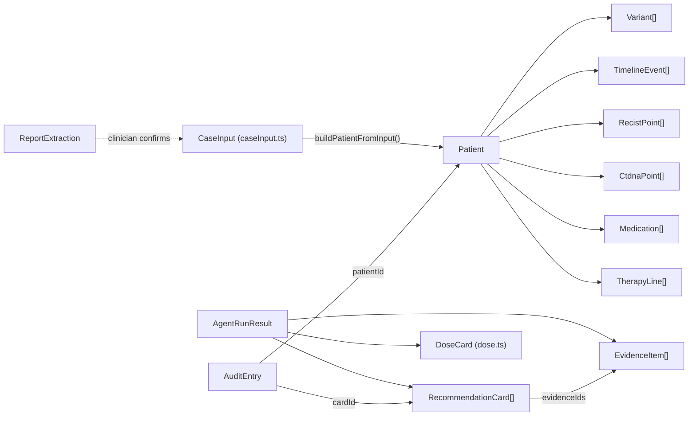
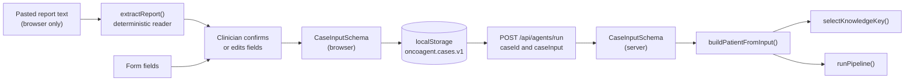
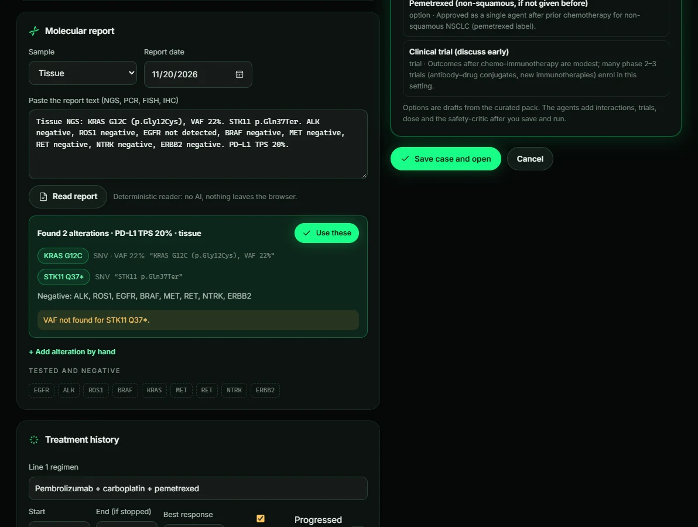

# Data

The data model, the three fictional demo patients, clinician-entered cases and how they are read, the knowledge pack, live sources and their snapshots, provenance and licences, privacy, and where data is kept.

> The three demo patients are fictional, written by the team. Clinician-entered cases must be de-identified or fictional; the public demo must never receive real patient data.

## 1. Data model

All types are in [types.ts](../app/src/lib/types.ts) unless noted.

### Patient

| Field | Type | Notes |
|---|---|---|
| `id` | string | Pseudonymous ID: `P-001` for demo patients, `C-XXXXXX` for entered cases |
| `displayName` | string | Fictional name, or the clinician's case label (or `Case C-XXXXXX`); shown in the workspace only, never sent to the language model |
| `age`, `sex` | number, `F` \| `M` | The model receives a decade band (`50s`) instead of the age |
| `smoking`, `diagnosis`, `histology`, `stage` | string | For entered cases `stage` includes the metastatic sites text |
| `ecog` | number | ECOG performance status |
| `weightKg`, `heightCm` | number | Dose calculation |
| `serumCreatinineMgDl`, `creatinineDate` | number, ISO date | Cockcroft–Gault; date drives the 7-day freshness block |
| `asOf` | ISO date, optional | The record's clinical "today"; freshness rules use it. Entered cases set it to the date they were saved |
| `pdl1Tps` | number, optional | PD-L1 tumour proportion score (%) |
| `variants`, `medications`, `therapyLines`, `events`, `recist`, `ctdna` | arrays | See below |
| `allergies` | string[] | Empty for entered cases |
| `question` | string | The event the agents are asked to act on |
| `status` | string | Short label for lists |
| `biomarkerKey` | string | Knowledge-pack entry, or empty when the pack does not cover the setting |
| `knowledgeReason` | string, optional | The setting selector's explanation (entered cases) |
| `trialQuery` | `{ condition, term }` | Query for ClinicalTrials.gov |

### Variant

| Field | Type | Notes |
|---|---|---|
| `gene` | string | HGNC symbol |
| `alteration` | string | Protein change or fusion (`L858R`, `G12C`, `EML4::ALK`, `Exon 19 Deletion`) |
| `kind` | `SNV` \| `fusion` \| `indel` \| `CNV` | |
| `hgvsP` | string, optional | HGVS protein notation (`p.Leu858Arg`) |
| `vafPercent` | number, optional | Variant allele fraction |
| `origin` | `somatic` \| `germline-suspected` | Entered cases are recorded as `somatic` |
| `sample` | `tissue` \| `plasma` | Plasma resistance findings are treated as acquired resistance |
| `reportedOn`, `lab` | ISO date, string | Entered cases: the report date and "Clinician-entered report" |

### TimelineEvent

`id` (registered as evidence `pt:<id>`), `date`, `kind` (`referral`, `imaging`, `pathology`, `molecular`, `treatment`, `tumor-board`, `lab`, `symptom`, `decision`), `title`, `detail`, `source` (the source document, for example "Radiology report").

### RecistPoint and CtdnaPoint

| Type | Fields | Notes |
|---|---|---|
| `RecistPoint` | `date`, `months`, `sumMm`, `newLesions`, `note?` | Sum of target-lesion diameters. [`assessRecist()`](../app/src/lib/clinical/recist.ts) adds `changeFromBaselinePct`, `changeFromNadirPct`, `nadirMm` and `category` (`Baseline`, `CR`, `PR`, `SD`, `PD`) |
| `CtdnaPoint` | `date`, `months`, `vafPercent` (null = not detected), `marker` | Empty for entered cases |

### Medication and TherapyLine

| Type | Fields | Notes |
|---|---|---|
| `Medication` | `name`, `indication`, `tags[]` | Tags drive the interaction checker: `qt-prolonging`, `strong-cyp3a-inducer`, `strong-cyp3a-inhibitor`, `acid-reducing`, `nsaid` |
| `TherapyLine` | `line`, `regimen`, `start`, `end?`, `bestResponse?`, `stopReason?` | |

### Intake types

| Type | Fields | Notes |
|---|---|---|
| `ExtractedVariant` | `gene`, `alteration`, `kind`, `hgvsP?`, `vafPercent?`, `matched` | `matched` is the exact text fragment behind the finding, shown to the clinician |
| `ReportExtraction` | `variants[]`, `pdl1Tps?`, `testedNegative[]`, `sample?`, `warnings[]` | Output of `extractReport()` |
| `KnowledgeSelectionInput` | `variants[]`, `priorRegimens[]`, `progressedOnCurrentLine`, `pdl1Tps?`, `histology` | Input of `selectKnowledgeKey()` |
| `KnowledgeSelection` | `key` (or null), `reason`, `trialTerm` | Output of `selectKnowledgeKey()` |

`CaseInput` and `StoredCase` are described in section 3.

### RecommendationCard and EvidenceItem

Field-by-field tables: [AGENTS.md](AGENTS.md#3-recommendation-card-schema). Evidence ID prefixes (`pt:`, `kb:`, `civic:`, `trial:`, `label:`, `calc:`): [ARCHITECTURE.md](ARCHITECTURE.md#25-data-flow-and-the-evidence-registry).

### DoseCard

From [dose.ts](../app/src/lib/clinical/dose.ts).

| Field | Notes |
|---|---|
| `regimenKey`, `regimenName` | From [regimens.ts](../app/src/lib/data/regimens.ts) |
| `bsa`, `crcl` | m² (Mosteller), mL/min (Cockcroft–Gault) |
| `lines[]` | Per drug: `drug`, `method` (`Calvert`, `Body surface area`, `Per kilogram`, `Weight band`, `Fixed dose`), `formula`, `inputs[]`, `raw`, `rounded`, `text`, `schedule`, `source`, `url` |
| `premedication[]` | From the label |
| `blocks[]` | Reasons the card must not be used (stale creatinine, low CrCl) |
| `warnings[]` | For example the GFR cap at 125 mL/min |
| `asOf` | Which weight, height and creatinine were used |

### AuditEntry

| Field | Notes |
|---|---|
| `seq` | 1, 2, 3 … |
| `at` | ISO time |
| `actor` | `Dr. Demo` in the MVP |
| `action` | `approve`, `modify`, `reject` or `agent-run` |
| `cardId`, `patientId` | |
| `reasonCode`, `reasonText` | Reason code required for modify and reject; `Approved despite safety-critic flag` when a flagged card is approved |
| `prevHash` | Hash of the previous entry (64 zeros for the first) |
| `hash` | SHA-256 of the JSON of the entry without `hash` |

[`appendAudit()`](../app/src/lib/audit.ts) writes entries; `verifyAudit()` recomputes every hash and link.

## 2. The three fictional cases

Defined in [patients.ts](../app/src/lib/data/patients.ts), frozen at `asOf` 2026-11-20 (`CASE_AS_OF`). Each case is built around one hard decision.

| | P-001 | P-002 | P-003 |
|---|---|---|---|
| Fictional name | Rahela Khatun | Karim Uddin | Nasrin Akter |
| Age, sex, smoking | 55, F, never smoked | 61, M, former smoker (30 pack-years) | 45, F, never smoked |
| Disease | Adenocarcinoma, stage IVB (bone, mediastinal nodes) | Adenocarcinoma, stage IVB (liver, left adrenal) | Adenocarcinoma, stage IVB (brain, pleura) |
| Molecular | EGFR L858R + TP53 R273H (tissue); EGFR C797S 1.2% (plasma) | KRAS G12C + TP53 R248Q; PD-L1 TPS 60% | EML4::ALK fusion; PD-L1 TPS 5% |
| History | Osimertinib from 2025-09-24, partial response, progression 2026-11-16: 45 mm vs 32 mm nadir, new 1.4 cm liver lesion | Treatment-naive | Treatment-naive; seizure, carbamazepine started in the emergency department |
| Medications that matter | Osimertinib and citalopram (both QT-prolonging) | Amlodipine, metformin | Carbamazepine (strong CYP3A inducer), dexamethasone |
| The decision | Next line after osimertinib with an on-target resistance mutation | First-line choice with a driver whose drugs are approved only later | First-line ALK inhibitor while on an interacting antiseizure drug |
| Knowledge key | `EGFR_POST_OSIMERTINIB` | `KRAS_G12C_1L` | `ALK_1L` |
| Gold leading option | Amivantamab + carboplatin + pemetrexed | Pembrolizumab | Alectinib |
| Structure (RCSB PDB) | 1M17: EGFR + erlotinib; L858, C797, T790 | 6OIM: KRAS G12C + sotorasib; C12 | 2XP2: ALK + crizotinib; L1196, G1202 |

P-001 dose example (from the calculators): BSA 1.51 m², CrCl 67.7 mL/min, carboplatin AUC 5 = 460 mg, pemetrexed 500 mg/m² = 750 mg.

The 10-marker NSCLC panel used by the Test-advisor (`NSCLC_PANEL`): EGFR, ALK, ROS1, BRAF, KRAS, MET, RET, NTRK, ERBB2, PD-L1.

## 3. Clinician-entered cases

A clinician can enter a de-identified NSCLC case at `/cases/new` ([CaseForm.tsx](../app/src/components/CaseForm.tsx)) and run the same nine agents on it. Since v0.3.

### 3.1 CaseInput

`CaseInputSchema` (Zod) in [caseInput.ts](../app/src/lib/caseInput.ts). The same schema validates the form in the browser, the run API and the MCP `analyze_case` tool. The server always rebuilds the `Patient` from a validated input; it never accepts a client-built record.

| Field | Constraint |
|---|---|
| `label` | Optional, at most 40 characters. The clinician's own short label; must not contain identifiers. Shown only in the workspace |
| `age` | Integer 18 to 100 |
| `sex` | `F` or `M` |
| `smoking` | `never`, `former`, `current` |
| `histology` | `adenocarcinoma`, `squamous`, `nsclc-nos` |
| `stage` | `IIIB`, `IIIC`, `IVA`, `IVB` |
| `sites` | Optional, at most 80 characters |
| `ecog` | Integer 0 to 4 |
| `pdl1Tps` | Optional, 0 to 100 |
| `weightKg`, `heightCm` | 25 to 250 kg, 120 to 220 cm |
| `creatinineMgDl`, `creatinineDate` | 0.2 to 15 mg/dL; a real `YYYY-MM-DD` date |
| `reportDate` | Real `YYYY-MM-DD` date of the molecular report |
| `variants` | Up to 12: `gene` (2 to 8 upper-case letters or digits), `alteration` (1 to 40 characters), `kind`, `vafPercent?` (0 to 100), `sample` (`tissue` or `plasma`), `hgvsP?` |
| `testedNegative` | Up to 20 gene symbols |
| `priorLines` | Up to 4: `regimen` (2 to 80 characters), `start`, `end?`, `bestResponse?` (`Complete response`, `Partial response`, `Stable disease`, `Progressive disease`, `Not assessed`), `progressed` |
| `medications` | Up to 20 names (2 to 60 characters each) |
| `recist` | Up to 12 scans: `date`, `sumMm` (0 to 1000), `newLesions` |
| `question` | Optional, at most 400 characters |
| `asOf` | Real `YYYY-MM-DD` date; the form sets the save date (Asia/Dhaka) |

No field asks for a name, record number, address, phone number or date of birth. The pasted report text is not part of `CaseInput`: it stays in the form and is never saved or sent to the server from the workspace.

Case IDs come from `newCaseId()`: `C-` plus six characters from a 32-character alphabet without look-alike characters, drawn with `crypto.getRandomValues`, matching `CASE_ID_PATTERN = /^C-[A-Z0-9]{6}$/`.

### 3.2 From input to Patient

`buildPatientFromInput(input, id)` is deterministic: the same input gives the same record.

| Patient part | Built from |
|---|---|
| Therapy lines | `priorLines` sorted by start date, numbered from 1; `stopReason: "Progression"` when `progressed` |
| Variants | `variants`, with `origin: "somatic"`, `reportedOn: reportDate`, `lab: "Clinician-entered report"` |
| Knowledge key | `selectKnowledgeKey()` (section 3.4); its reason goes into `knowledgeReason` and its trial term into `trialQuery.term` |
| Medications | Each name with `indication: "Entered by clinician"` and tags from `tagsFor()` (section 4.3) |
| RECIST | Scans sorted by date, months from the first scan |
| Timeline (`pt:` evidence) | One "Diagnosis" event (histology, stage, sites, ECOG, PD-L1); one "CT measurement" per scan; one "started" event per line; one molecular-report event listing variants and negatives; one "Kidney function" lab event. Numbered `e1`, `e2` … in date order |
| Question | `question`, or a default: next-line options after progression, otherwise first-line options |
| Status | "Progression · next line", "On treatment" or "New diagnosis · first line" |

### 3.3 Report reader

`extractReport(text)` in [extract.ts](../app/src/lib/clinical/extract.ts) reads pasted NGS, PCR, FISH or IHC report text with regular expressions. No language model is involved, and in the workspace it runs in the browser.

What it finds:

- EGFR exon 19 deletion, exon 20 insertion and point mutations; KRAS and NRAS; BRAF; ERBB2/HER2; MET exon 14 skipping and amplification
- ALK, ROS1, RET, NTRK and NRG1 fusions
- Common co-mutations (TP53, STK11, KEAP1, PIK3CA, SMARCA4, CDKN2A and others in its gene list)
- VAF per alteration, PD-L1 TPS, genes reported negative, and the sample type (tissue or plasma)
- Protein notation in one- or three-letter form (`p.Leu858Arg` → `L858R`); gene aliases (HER2 → ERBB2, c-MET → MET); impossible positions are rejected using protein lengths

How it stays conservative: an alteration is returned only when a gene and a specific change are both stated and the statement is not negated, hedged ("pending", "recommended"), labelled a variant of uncertain significance or benign, or written as general commentary ("C797S confers resistance…"). Anything unclear becomes a warning for the clinician, never a variant. Warnings cover, among others: PD-L1 given as a range or as CPS, VAF without a % sign, conflicting statements, low tumour content, germline mentions, alterations in genes it does not cover, more than one main driver, and possible alterations in interpretive text.

Each finding carries the exact text fragment that produced it. The clinician presses "Use these" to copy the findings into the form and then checks each one. 81 unit tests cover realistic and messy reports, alteration names, VAF, PD-L1, negatives, ignored and hedged statements, sample quality and an explicit "no false positives" set ([extract.test.ts](../app/src/lib/clinical/extract.test.ts)).

Not covered: PDF upload and scanned images (planned).

### 3.4 Setting selector

`selectKnowledgeKey(input)` in [select.ts](../app/src/lib/clinical/select.ts) picks which knowledge-pack entry the agents should read. It never proposes treatment itself.

1. **Driver**, by precedence: EGFR (exon 19 deletion or L858R, then exon 20 insertion), ALK, ROS1, BRAF V600E, MET exon 14 skipping, RET, NTRK, KRAS G12C, ERBB2 mutation. Co-mutations are not drivers. An EGFR resistance alteration after an EGFR inhibitor keeps the case on the EGFR pathway.
2. **Line of therapy**: prior regimens are classified by drug class (osimertinib, earlier EGFR inhibitors, amivantamab, platinum, docetaxel, PD-1/PD-L1 inhibitors, each targeted class). Radiotherapy and surgery alone are not systemic lines. When progression is recorded, all prior lines count as failed; otherwise the latest line is treated as current.
3. **Entry**: the entry for the next decision after the failed lines, using PD-L1 and histology for driver-negative cases.
4. **Not covered**: when no entry fits (for example uncommon EGFR mutations, progression after amivantamab, a second targeted line), it returns `key: null` with a reason, and the agents propose no treatment.

The reason also carries notes for the clinician: additional drivers, progression recorded without a prior regimen, targeted therapy in the history without a matching driver, driver-negative on plasma only, and the current line when no progression is recorded. The form shows the chosen entry, the reason and the trial term in a live preview before saving. 65 unit tests cover one case per entry, edge cases, pack integrity, interaction rules and the catalogue, weight-band and per-kg dosing, and that the original demo entries are unchanged ([knowledge.test.ts](../app/src/lib/clinical/knowledge.test.ts)).

### 3.5 Example cases

The form offers four examples to start from: EGFR exon 19 deletion (new diagnosis), KRAS G12C after chemo-immunotherapy (second line, on omeprazole), ROS1 fusion by FISH (new diagnosis, on a strong CYP3A inducer) and no driver with PD-L1 80% (squamous, first line).

### 3.6 StoredCase

[cases.ts](../app/src/lib/cases.ts) keeps cases in browser `localStorage` under `oncoagent.cases.v1`, newest first, as `{ id, createdAt, updatedAt, input }`. Entries that fail `CaseInputSchema` on read are dropped. `deleteCase()` removes the case and its live run; signed audit entries are kept. A case exists only in the browser where it was created.

## 4. Knowledge pack

[knowledge.ts](../app/src/lib/data/knowledge.ts), version string `KNOWLEDGE_VERSION = "nsclc-pack 2026-11-20"`.

A curated summary of public regulatory approvals and pivotal trials. It is not a guideline. Every entry must be checked against the current product label and the current NCCN or ESMO guideline before clinical use, and the Guideline card says so.

### 4.1 Entries

20 entries. Three back the demo patients; 17 are generic settings used by entered cases.

| Key | Setting |
|---|---|
| `EGFR_POST_OSIMERTINIB` | Demo P-001: EGFR-mutant, progressing on osimertinib |
| `KRAS_G12C_1L` | Demo P-002: KRAS G12C, treatment-naive, PD-L1 ≥ 50% |
| `ALK_1L` | Demo P-003: ALK-positive, treatment-naive, brain metastases |
| `EGFR_COMMON_1L` | EGFR exon 19 deletion or L858R, EGFR-inhibitor naive |
| `EGFR_EX20_1L` | EGFR exon 20 insertion, treatment-naive |
| `EGFR_PROGRESSION` | EGFR-mutant after osimertinib, no prior platinum |
| `ALK_1L_STD` | ALK-positive, ALK-inhibitor naive |
| `ROS1_1L` | ROS1-positive, ROS1-inhibitor naive |
| `BRAF_V600E_1L` | BRAF V600E, BRAF-inhibitor naive |
| `MET_EX14_1L` | MET exon 14 skipping, MET-inhibitor naive |
| `RET_1L` | RET fusion, RET-inhibitor naive |
| `NTRK_1L` | NTRK fusion, any line without a TRK inhibitor |
| `KRAS_G12C_POST` | KRAS G12C after prior systemic therapy |
| `ERBB2_MUT_1L` | HER2-mutant non-squamous, treatment-naive |
| `ERBB2_MUT_POST` | HER2-mutant after prior systemic therapy |
| `NO_DRIVER_PDL1_HIGH` | No actionable driver, PD-L1 ≥ 50% |
| `NO_DRIVER_NONSQ` | No driver, non-squamous, PD-L1 < 50% |
| `NO_DRIVER_SQ` | No driver, squamous, PD-L1 < 50% |
| `SECOND_LINE_NO_DRIVER` | No driver, after platinum chemo-immunotherapy |
| `SECOND_LINE_IO_NAIVE` | No driver, after platinum chemotherapy, immunotherapy-naive |

### 4.2 Structure and counts

| Content | Count | Structure |
|---|---|---|
| Biomarker entries | 20 | `BiomarkerEntry`: `key`, `title`, `setting`, `driver` (gene, alteration, meaning), `options[]`, `notRecommended[]`, `testsToConsider[]` |
| Drugs across all options | 42 | — |
| Therapy options | 79 | `TherapyOption`: `id`, `regimen`, `drugs[]`, `rank`, `role` (`preferred`, `option`, `later-line`, `trial`), `basis`, `notes`, `regimenKey?`, `url` |
| Interaction rules | 54 | `InteractionRule`: `drug`, `medTag`, `severity`, `message`, `source` (label section). By tag: strong CYP3A inducer 21, strong CYP3A inhibitor 18, QT 8, acid-reducing 6, NSAID 1. By severity: avoid 45, monitor 8, contraindicated 1 (lorlatinib with strong CYP3A inducers) |
| Regimens | 34 | [regimens.ts](../app/src/lib/data/regimens.ts): components by method (fixed 28, BSA 8, Calvert 5, weight band 4, per kg 2), schedule, label source and DailyMed link, premedication, renal rule. Weight band: amivantamab, selpercatinib, zongertinib. Per kg: trastuzumab deruxtecan, ramucirumab |
| Medication catalogue | 59 | See 4.3 |
| Structures | 3 | [structures.ts](../app/src/lib/data/structures.ts): PDB ID, ligand residue, highlighted residues with role and note |

Structures for entered cases: `structureForVariants()` shows 1M17 for EGFR, 6OIM for KRAS G12C and 2XP2 for ALK, highlighting only the residues that apply to the entered alterations; other drivers show no structure. Residue numbers were checked against each PDB coordinate file. 1M17 uses mature EGFR numbering, 24 lower than the clinical numbering (C773 in the file is C797, L834 is L858, T766 is T790).

### 4.3 Medication catalogue

[medications.ts](../app/src/lib/data/medications.ts): 59 common co-medications of oncology patients in Bangladesh, each with a group, interaction tags and an optional note. Tags: QT-prolonging 21, acid-reducing 8, NSAID 7, strong CYP3A inhibitor 6, strong CYP3A inducer 5. Only well-established properties are tagged; moderate inhibitors and inducers are noted but not tagged.

`tagsFor(name)` gives the tags for a free-text entry such as "Omeprazole 20 mg daily": case-insensitive whole-word matching against catalogue names and a short alias list of international and spelling variants (for example rifampin for rifampicin, acetaminophen for paracetamol, albuterol for salbutamol), with the union of tags when several drugs are named. An unknown name gets no tags, so its interactions are not checked. The form's medication picker suggests catalogue names and shows the tags as amber chips.

### 4.4 Versioning rules

1. Any change to `knowledge.ts`, `regimens.ts`, `interactionRules` or `medications.ts` updates `KNOWLEDGE_VERSION` to the date of the change.
2. The version is written into every `kb:` evidence item, so a stored run shows which pack it used.
3. After a change: `npm test` (the knowledge tests check integrity and that demo entries are unchanged), `npm run precompute`, `npm run eval`, review the diff, commit together.
4. Production (planned): the pack becomes a reviewed knowledge service with an editor role, a second reviewer, an effective date and a change log.

## 5. Live sources and snapshots

| Source | Client | Query | Timeout | Fallback | Snapshot file |
|---|---|---|---|---|---|
| CIViC GraphQL (`https://civicdb.org/api/graphql`) | [civic.ts](../app/src/lib/tools/civic.ts) | `molecularProfiles(name)`, 60 evidence items | 12 s | Snapshot, then an empty result (`source: "none"`) | [cache/civic.json](../app/src/lib/tools/cache/civic.json): 6 profiles of the demo patients |
| ClinicalTrials.gov API v2 (`https://clinicaltrials.gov/api/v2/studies`) | [trials.ts](../app/src/lib/tools/trials.ts) | Condition and term, `RECRUITING`, sorted by last update | 12 s | Snapshot, then no trials | [cache/trials.json](../app/src/lib/tools/cache/trials.json): the 3 demo queries, up to 10 studies each |
| RCSB PDB (`https://files.rcsb.org/download/<id>.cif`) | [MoleculeViewer.tsx](../app/src/components/MoleculeViewer.tsx) (in the browser) | One mmCIF file per record view | Browser | A link to the structure on rcsb.org | — |

Every result carries `source` (`live`, `cache` or `none`) and the card says "live" or "snapshot". The snapshots cover the demo patients only; for an entered case with a different alteration or trial term, an outage gives an explicit "no evidence" or "no trial found" card. `npm run snapshot` ([snapshot.ts](../app/scripts/snapshot.ts)) refreshes both cache files.

Known gap: the cache files do not store the date they were fetched, and `fetchedAt` on a snapshot result is the time it was read. Until the fetch date is stored in the file (planned), the snapshot date is the commit date of the cache file.

Stored agent runs ([snapshots/P-00x.json](../app/src/lib/data/snapshots)) are full `PipelineResult` objects made by `npm run precompute` with Claude, for the demo patients only.

## 6. Provenance and licences

| Data | Origin | Licence or terms | How it is used |
|---|---|---|---|
| Demo patient records | Written by the team | Repository licence (MIT) | Demonstration only |
| Example cases in the form | Written by the team | Repository licence (MIT) | Starting points for the intake form |
| Variant evidence | [CIViC](https://civicdb.org) | CC0 1.0 (public domain dedication) | Evidence items cited by ID with a link |
| Trials | [ClinicalTrials.gov](https://clinicaltrials.gov), U.S. National Library of Medicine | Public registry; use follows the site's terms and conditions | NCT ID, title, phase, status, sponsor, countries, link |
| Protein structures | [RCSB PDB](https://www.rcsb.org) | PDB archive data are available under CC0 1.0 | Loaded in the browser for display |
| Dose parameters and interaction rules | Product labels via [DailyMed](https://dailymed.nlm.nih.gov), National Library of Medicine | Public label information | Parameters summarised in code with a DailyMed search link; no label text republished beyond the parameters |
| Approval references | U.S. FDA oncology approval notifications | Public | Link on knowledge-pack options |
| Knowledge pack and medication catalogue | Curated by the team from the public sources above | Repository licence (MIT) | Must be checked against current labels and guidelines |
| 3D viewer | Mol* 4.18 (molstar), loaded from jsDelivr | MIT | Rendering only |
| Font | Inter via `next/font/google` | SIL Open Font License 1.1 | UI typography |
| Model output | Claude Opus 5.5 via the Anthropic API | Anthropic commercial terms | Drafts for clinician review, stored in runs |

Not used: OncoKB (needs a commercial licence), NCCN content (redistribution limits), AlphaFold 3 (non-commercial weights). See [RESEARCH.md](RESEARCH.md).

## 7. Privacy and de-identification

| What | Behaviour |
|---|---|
| Collected by the intake form | Age, sex, clinical fields, free-text label, sites, regimen names, medication names and question. No name, record number, address, phone number or date of birth field |
| Pasted report text | Read in the browser; not saved and not sent to the server by the workspace. The MCP `extract_report` tool does send text to the server, and its description asks callers to remove identifiers first |
| Sent to the server for a case run | The validated `CaseInput` (including the label); the server rebuilds the record in memory and stores nothing |
| Sent to Claude | Pseudonymous ID, age band, sex, smoking, diagnosis, stage with sites, ECOG, PD-L1, variants, therapy lines, RECIST, ctDNA, medication names and tags, the question, the evidence list (including timeline event text) and draft card summaries ([claude.ts](../app/src/lib/agents/claude.ts)) |
| Never sent to Claude | Display name or case label, exact age, weight, height, creatinine, allergies, pasted report text |
| Returned by MCP `get_case_timeline` | Age band instead of age; no display name |
| Sent to CIViC and ClinicalTrials.gov | Gene and alteration; condition and trial term. No patient data |
| Sent to RCSB and jsDelivr (from the browser) | The PDB ID and the viewer files. No patient data |

Free-text fields of an entered case reach the model as written, and dates are sent at day precision. The form warns against identifiers, but nothing detects them yet. That is acceptable for fictional or de-identified demonstration cases only. Before real data, the planned de-identification gateway shifts or coarsens dates, scrubs free text and enforces minimum necessary context ([SAFETY.md](SAFETY.md#4-privacy-and-data-protection)).

## 8. Retention

| Data | MVP | Production (planned) |
|---|---|---|
| Entered cases | Browser `localStorage`, key `oncoagent.cases.v1`. Kept until deleted in the workspace or until site data is cleared. Not shared between browsers or users | The hospital's own database, inside its network, with access control and retention per policy and law |
| Audit log | Browser `localStorage`, key `oncoagent.audit.v1`, an array of `AuditEntry`. Kept until the user clears site data; deleting a case keeps its audit entries | Append-only server table with signed entries, backed up |
| Live runs | Browser `localStorage`, key `oncoagent.run.v1.<patientId or caseId>`, one `PipelineResult` each. Replaced by the next live run; removed by "Stored run" (demo patients) or by deleting the case | Server run store linked to the audit log and the model and prompt versions |
| MCP decisions | Server memory per instance; lost on restart | Same table as the audit log |
| Server logs | Platform default request logs; the app writes no patient data to logs | Central logging with PHI controls and a retention schedule |
| Stored runs, snapshots, eval results | Committed to the repository | Versioned artefacts in the evaluation store |

If browser storage is full or blocked (for example in some private windows), saving a case fails with a message, a finished run stays on screen for the visit only, and new audit entries are not kept after the page reloads.
