# Design system

The visual and interaction system of the clinician workspace. Source of truth: [globals.css](../app/src/app/globals.css) and the components in [app/src/components/](../app/src/components). There is no CSS framework; every style below is plain CSS with custom properties.

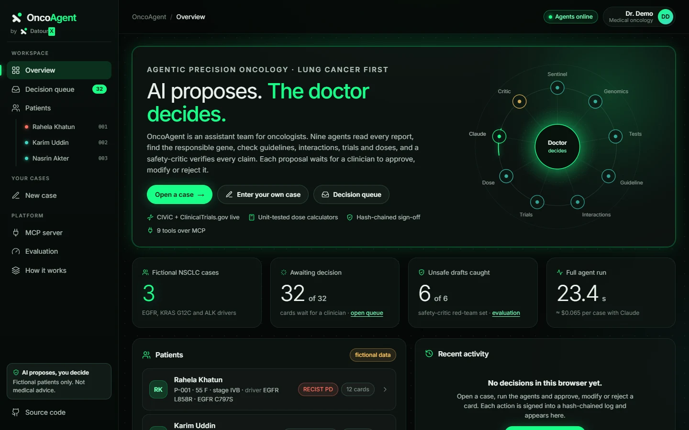

## 1. Principles

1. **One committed dark look.** Oncologists read records for long sessions, often in dim reading rooms. The workspace has one dark theme (`color-scheme: dark`) and no light mode. The printable report is the exception: it is black on white for paper.
2. **Mint means AI and live state.** The brand mint (`#17ff88`) marks AI output, live runs, the primary action and "passed" states. It is never used for a warning.
3. **Amber and red are reserved for safety.** Amber marks critic flags, interactions and anything that needs a second look. Red marks progression, rejection, blocks and errors. They are not used for decoration.
4. **Evidence is one click away.** Cards are compact by default; reasoning, uncertainty, alternatives and sources open in place or in the evidence drawer.
5. **Numbers are calm and exact.** Tabular figures, units next to values, formulas shown under calculated doses.
6. **Fictional, entered and draft states are always labelled.** "Fictional patient", "Clinician-entered case · de-identified", "AI draft", "Stored run" or "Live run" chips appear wherever they apply.

## 2. Colour tokens

Defined on `:root` in [globals.css](../app/src/app/globals.css).

| Token | Value | Use |
|---|---|---|
| `--bg` | `#050807` | Page background |
| `--bg-2` | `#0a100d` | Secondary background |
| `--panel` | `rgba(15, 22, 19, 0.74)` | Glass panels (with 16 px backdrop blur) |
| `--panel-solid` | `#0f1613` | Dialogs, drawer, popovers |
| `--panel-2` | `rgba(22, 32, 27, 0.78)` | Cards, buttons |
| `--panel-3` | `rgba(30, 43, 37, 0.7)` | Button hover |
| `--line` | `rgba(140, 255, 200, 0.09)` | Hairline borders |
| `--line-2` | `rgba(140, 255, 200, 0.17)` | Stronger borders, chips |
| `--text` | `#e9f2ed` | Primary text |
| `--text-2` | `#b0c0b7` | Secondary text |
| `--muted` | `#7a8c82` | Labels, captions, axis text |
| `--mint` | `#17ff88` | Brand, AI, primary action, focus ring |
| `--mint-2` | `#6dffb6` | Mint text and links on dark |
| `--mint-dim` | `#13a35c` | Quiet mint (timeline nodes) |
| `--mint-wash`, `--mint-wash-2` | mint at 8% and 14% | Selected and active backgrounds |
| `--glow` | mint ring plus 32 px glow | Highlighted panels (agent run, dose card) |
| `--teal` | `#3fd7c4` | Second data colour (ctDNA, imaging, CIViC chips) |
| `--amber` | `#ffc65c` | Critic flags, interactions, modify |
| `--amber-wash` | amber at 10% | Flag backgrounds |
| `--red` | `#ff6f61` | Progression, reject, blocks, errors |
| `--red-wash` | red at 10% | Reject and block backgrounds |

Contrast against the page background `#050807` (WCAG 2 ratios, computed from the token values):

| Foreground | Ratio on `--bg` | Ratio on `--panel-solid` |
|---|---|---|
| `--text` | 17.6:1 | 16.1:1 |
| `--text-2` | 10.6:1 | 9.7:1 |
| `--muted` | 5.7:1 | 5.2:1 |
| `--mint` | 15.0:1 | 13.7:1 |
| `--teal` | 11.2:1 | 10.2:1 |
| `--amber` | 12.9:1 | 11.8:1 |
| `--red` | 7.4:1 | 6.7:1 |
| Ink `#041a0d` on `--mint` (primary button) | 13.5:1 | — |

All pass WCAG AA for normal text (4.5:1). Translucent panels sit between `--bg` and `--panel-solid`, so real ratios fall inside these ranges.

### Data colours

| Meaning | Colour |
|---|---|
| Sum of target lesions (RECIST chart line and area) | `--mint` |
| Partial-response threshold (−30% from baseline) | `--teal`, dashed |
| Progression threshold (+20% from nadir) | `--red`, dashed |
| Point in progression | `--red` |
| ctDNA variant allele fraction | `--teal`; "not detected" as a hollow grey circle |
| 3D structure: driver residue | `--mint` |
| 3D structure: resistance residue | `--red` |
| 3D structure: gatekeeper or site residue | `--amber` |
| 3D structure: drug | `--text` |
| Timeline nodes | molecular mint, imaging teal, pathology grey-green, treatment and tumour board amber, symptom red |

Colour is never the only signal: every coloured state also has a text label (for example "critic flag", "PD", "blocked", "resistance").

## 3. Typography

| Role | Style |
|---|---|
| Font | Inter, loaded with `next/font/google` as `--font-inter`, falling back to Segoe UI and system UI |
| Monospace | `ui-monospace`, Cascadia Mono, SF Mono, Menlo (`--mono`) for IDs, formulas, code and evidence IDs |
| Body | 15 px, line height 1.55 |
| Hero heading | `clamp(30px, 3.4vw, 44px)`, weight 400, tracking −0.04em, mint emphasis in weight 500 |
| Patient name | 28 px, weight 400 |
| Big numbers (stat tiles) | 46 px, weight 300 (38 px on phones) |
| Panel titles | 15 px, weight 600, mint icon |
| Card proposal | 15.5 px, weight 500 |
| Eyebrow labels | 11 px, weight 600, uppercase, tracking 0.14em, `--muted` |
| Chips | 12 px, weight 500 |
| Table headers | 11 px uppercase, tracking 0.1em |

Numbers in tables, dose cards, timers and timelines use `font-variant-numeric: tabular-nums`.

## 4. Spacing, radii and layout

| Token or rule | Value |
|---|---|
| `--radius` | 18 px (panels, cards, dialogs) |
| `--radius-sm` | 12 px (inner tiles, code blocks, step tiles) |
| Chips and buttons | Fully rounded (999 px) |
| Grid gap | 18 px |
| Panel padding | 20 px (hero 30 px) |
| Content padding | 26 px × 28 px (18 px × 16 px below 900 px) |
| Content max width | 1480 px |
| Top bar height (`--topbar-h`) | 69 px (57 px below 900 px) |
| Sidebar | 248 px, sticky |
| Button height | 40 px (34 px small) |

Layout primitives: `.grid` with `.g2`, `.g3`, `.g4`; `.split` (two uneven columns), `.split.work` (cards and side panel), `.stack` (vertical, 18 px gap), `.row` (wrapping horizontal).

## 5. Components

| Component | Where | Notes |
|---|---|---|
| Panel | `.panel`, `.panel.glow` | Glass surface with blur; `glow` for the agent run, dose card and hero |
| Chip | `.chip` with `mint`, `solid`, `amber`, `red`, `ghost`; `as-btn` for filters | Status, kind, origin, confidence. `solid` mint marks Claude cards |
| Button | `.btn`, `.primary`, `.danger`, `.sm`, `.ghost-btn`; `.link-btn`, `.icon-btn` | Primary is mint with dark ink; danger is red outline |
| Recommendation card | `Card` in [AgentWorkspace.tsx](../app/src/components/AgentWorkspace.tsx), `.rc` | Header chips (origin, kind, critic, decision, confidence meter), proposal, first three reasons, critic note, expandable grid (evidence, confidence, uncertain, alternatives, changes if, safety, critic), actions. States: `claude`, `flagged` (amber border), `decided-*` |
| Confidence meter | `.meter` | Three bars plus the word (`high`, `moderate`, `low`) |
| Evidence drawer | `EvidenceDrawer` | Right-side dialog, grouped by source type, focused item highlighted and scrolled into view, each item with "Open source" |
| Decision dialog | [DecisionDialog.tsx](../app/src/components/DecisionDialog.tsx) | Approve, modify or reject; reason code and text required for modify and reject; approving a flagged card shows the critic notes in an amber alert with an acknowledgement checkbox (`.ack`) and requires a reason; states the SHA-256 chaining |
| Toast | `Toaster` in DecisionDialog.tsx | Bottom-right, `aria-live="polite"`, mint, amber or red edge, 3.8 s |
| Agent steps | `.steps`, `.stepc` | Nine tiles with status dot, note and time; `running` tile glows; progress bar on top |
| Dose card | `DoseView` | BSA and CrCl tiles, one line per drug with formula and label link, blocks and warnings in amber, premedication. When blocked, each amount is replaced by "withheld" in red capitals (`.dl-dose.withheld`) |
| Charts | [Charts.tsx](../app/src/components/Charts.tsx): `RecistChart`, `CtdnaChart` | Hand-built SVG, one axis, recessive grid, threshold lines, per-point hover and focus, table twin |
| Timeline | `.timeline` on the patient page | Date column, coloured node by event kind, title, detail, source and `pt:` ID |
| Sub-navigation | [SubNav.tsx](../app/src/components/SubNav.tsx) | Sticky pill bar for record sections; highlights the section in view |
| Health chip | `HealthChip` in [Shell.tsx](../app/src/components/Shell.tsx) | "Agents online", "Rules-only mode", "Snapshot mode" or "Status unknown"; popover with each source |
| Molecule viewer | [MoleculeViewer.tsx](../app/src/components/MoleculeViewer.tsx) | Mol* with a MolViewSpec scene: cartoon protein, drug and residues as labelled sticks, camera framed on the pocket; spin and reset; plain-structure and link fallbacks |
| Decision queue | [QueueView.tsx](../app/src/components/QueueView.tsx) | Flagged first, then safety, treatment, tests; filters by patient and kind; approve, modify or reject in place |
| Report paper | [ReportView.tsx](../app/src/components/ReportView.tsx), `.paper` | Light A4 sheet with the record, AI pre-read, cards and decisions, dose card, signature lines, numbered sources, audit-chain footer; used for demo patients and entered cases |
| Patient record | [PatientRecord.tsx](../app/src/components/PatientRecord.tsx) | One record screen for demo patients (server-rendered) and entered cases (browser-rendered); a "Clinician-entered case · de-identified" chip, the setting reason when the pack does not cover the case, and Edit and Delete actions for cases |
| Case form | [CaseForm.tsx](../app/src/components/CaseForm.tsx), `.case-form` | Example-case buttons (`.ex`); fieldsets with legends for patient, diagnosis, molecular report, treatment history, measurements, body and kidney function, medications and question (`fieldset.fs`); auto-fill field grid (`.fgrid`, 150 px minimum); per-field errors (`.field.bad`, red border and message) |
| Report reader panel | `.extract`, `.ext-row` in CaseForm.tsx | "Read report" button, then a mint panel with one chip per finding, its type and VAF, the matched text in quotes, genes reported negative and amber warnings; "Use these" copies the findings into the form |
| Variant, line and scan rows | `.vrow`, `.lrow`, `.srow` | Editable rows with labelled inputs and a remove button; "tested and negative" genes as toggle chips (`aria-pressed`) |
| Medication picker | `.medpick`, `.medlist`, `.chip-x` | Type to search the catalogue; suggestions show group and interaction tags; Enter adds the first match; chosen medicines become chips, amber when they carry interaction tags, each with a remove button |
| Live preview | `.sticky-col`, `.opts` | Sticky side panel (wide screens) with BSA, CrCl, the chosen pack entry, the selector's reason, the trial term and the pack options; below it, an alert listing up to 8 invalid fields after a save attempt |
| Case list | [CaseList.tsx](../app/src/components/CaseList.tsx) | "Your cases" rows with label or ID, age, sex, stage, driver, last update, card count and critic flags |
| Client-only wrapper | [ClientOnly.tsx](../app/src/components/ClientOnly.tsx) | Renders children only in the browser, with a fallback, for screens that read browser storage on first render |

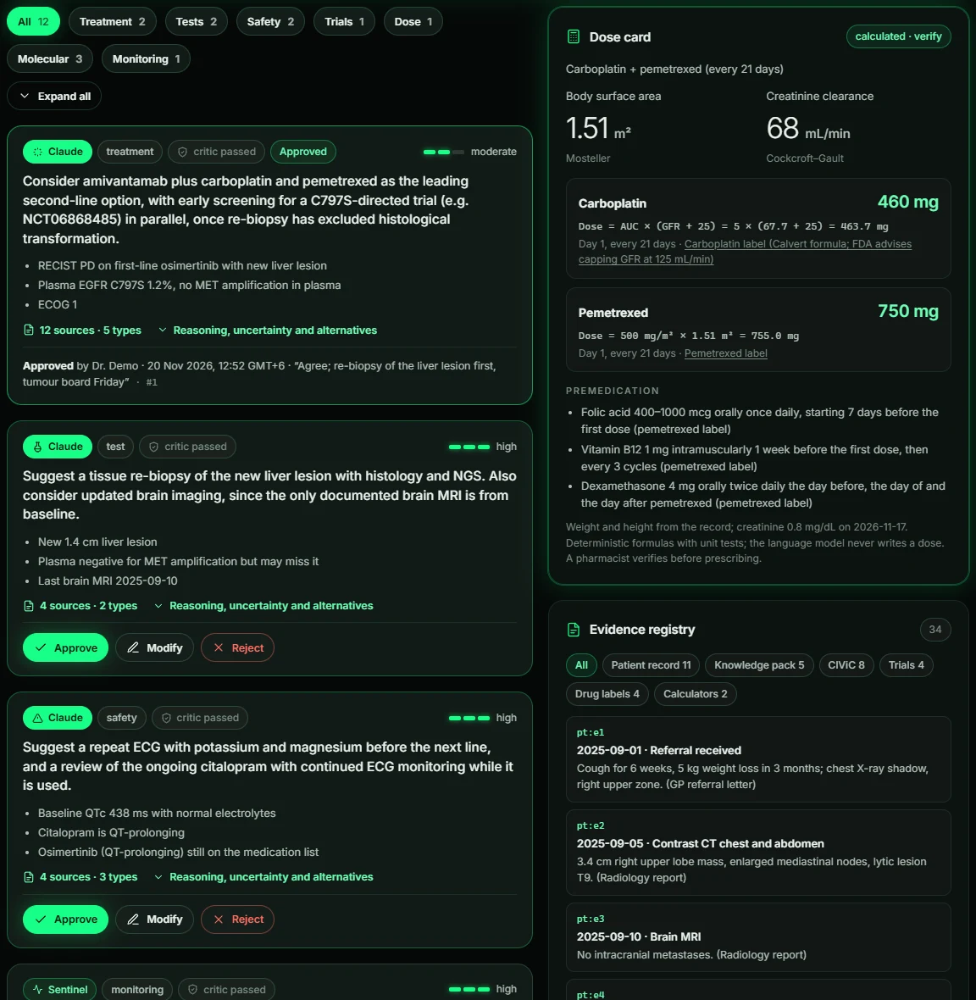

## 6. Accessibility

Implemented:

- **Focus:** `:focus-visible` draws a 2 px mint outline with 2 px offset on every interactive element. A "Skip to content" link appears on first Tab.
- **Landmarks and labels:** sidebar and breadcrumb are `nav` elements with labels; the main area is `main#main`; icon-only buttons have `aria-label`; the active navigation item has `aria-current="page"`.
- **Dialogs:** the decision dialog and the evidence drawer use `role="dialog"`, `aria-modal="true"` and `aria-labelledby`; Escape closes them; the decision dialog focuses its first field and returns focus to the button that opened it; the page behind stops scrolling.
- **Live regions:** agent steps (`aria-live="polite"`) and toasts (`role="status"`) are announced.
- **Forms:** required reasons show an inline error with `role="alert"`, `aria-invalid` and `aria-describedby`. The case form groups fields in `fieldset`/`legend` pairs, wraps every input in a `label`, gives row inputs an `aria-label` (Gene, Alteration, Type, VAF %), marks gene toggles with `aria-pressed`, and lists invalid fields in a `role="alert"` panel after a save attempt.
- **Charts:** each SVG has `role="img"` and an `aria-label` that reads out every value and the latest category; each point is focusable with its own label; "Show table" switches to a real data table with the same numbers.
- **Reduced motion:** `prefers-reduced-motion: reduce` disables all CSS animations and transitions (agent orbit, pulses, dialog and toast entrances, smooth scrolling). The Mol* structure spin is drawn in WebGL and is not affected by this setting; it can be stopped with the "Pause spin" button.
- **Contrast:** see section 2; all text tokens pass WCAG AA.
- **Language:** the document is `lang="en"`.

Known gaps (planned): a full focus trap inside dialogs (Tab can currently reach the page behind), arrow-key navigation in the medication suggestion list (its options are buttons reached with Tab), starting the Mol* view without spin when reduced motion is requested, a Bangla interface with `lang="bn"` labels, and a keyboard alternative to rotate the 3D structure beyond spin and reset.

## 7. Responsive rules

| Breakpoint | Change |
|---|---|
| ≤ 1380 px | Card column and side panel rebalance |
| ≤ 1180 px | Two-column layouts stack; four-up stat grids become two-up; the agent pipeline diagram becomes vertical; the case-form preview stops being sticky and follows the form |
| ≤ 900 px | Sidebar becomes a horizontal top strip (patients and footer hidden); single-column grids; queue rows stack; status popover becomes full width; case-form variant, line and scan rows use two columns |
| ≤ 760 px | Tables marked `stackable` turn into cards: header row hidden, each cell shows its column name from `data-label` |
| ≤ 560 px | One column everywhere; card detail grid stacks; smaller big numbers; the decorative agent orbit is hidden; the status chip shows only its dot |
| Short screens (height ≤ 860, 760 or 640 px, width > 900 px) | Sidebar spacing tightens step by step; the footer notice, then the sidebar case list, then the brand subtitle are hidden |
| Print | A4 with 14 mm margins; sidebar, top bar and toasts hidden; sections avoid page breaks |

Rules that hold at every width:

- **No horizontal page scroll.** The main column uses `min-width: 0` and `overflow-x: clip`; long IDs and formulas wrap (`overflow-wrap: anywhere`); code blocks wrap instead of scrolling.
- **No visible scrollbars.** Scrollbars are hidden everywhere (`scrollbar-width: none` and the WebKit equivalent). Content still scrolls with wheel, touch and keyboard. The trade-off is less obvious overflow on the sub-navigation strip and the phone navigation strip, which scroll sideways inside their own box.
- **Tap targets:** buttons are at least 34 px tall; chart points have a 14 px invisible hit radius.

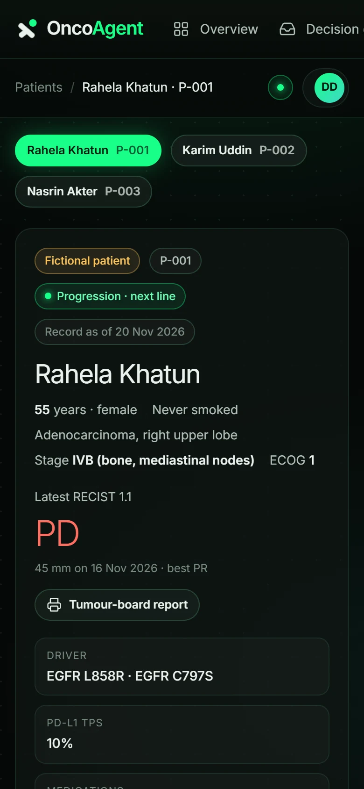

## 8. Screens

| Screen | Screenshot |
|---|---|
| Patient record | 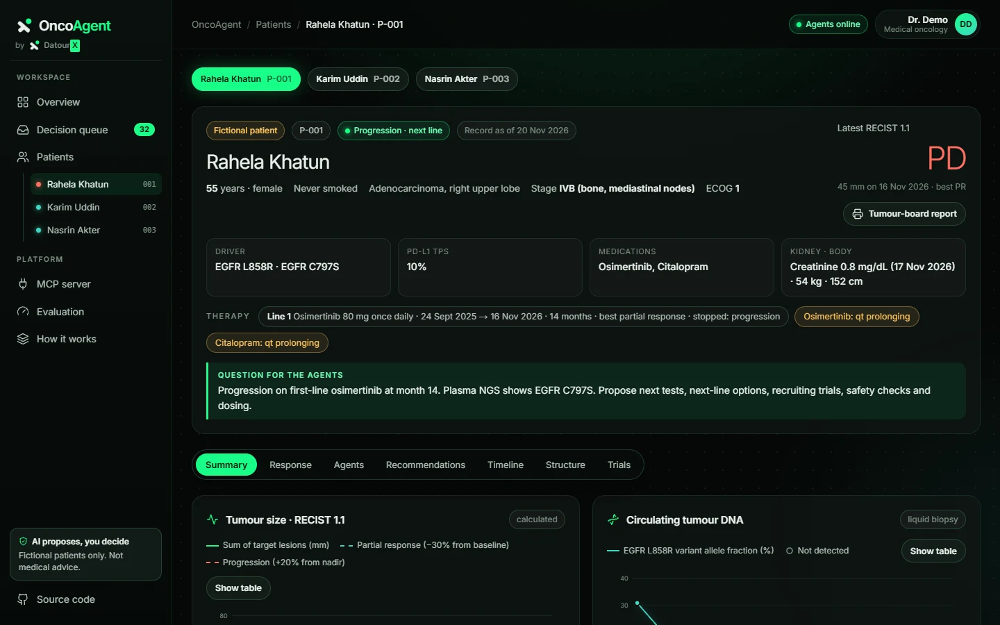 |
| Agent run in progress | 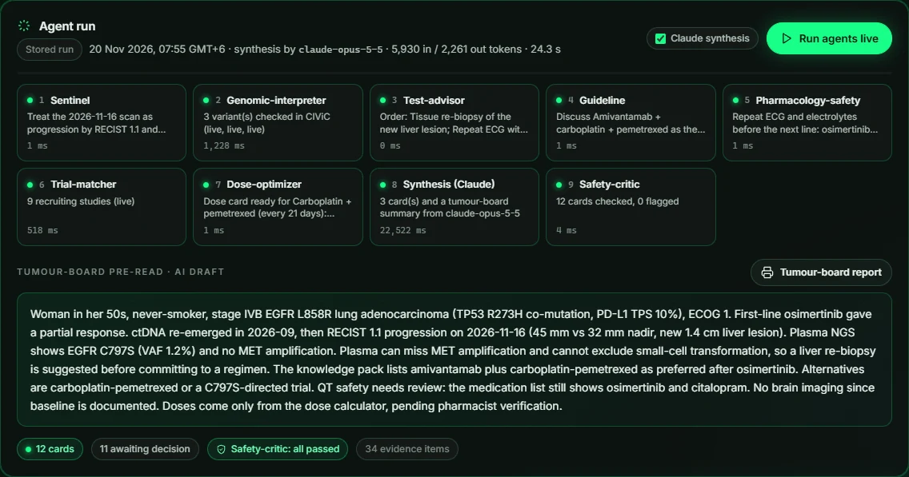 |
| Evidence drawer | 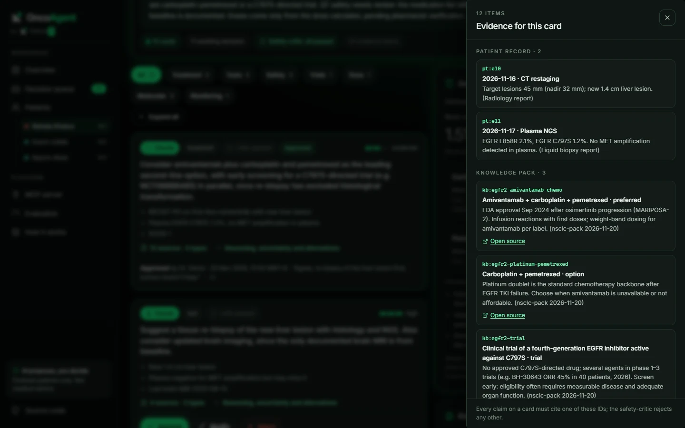 |
| Sign-off dialog | 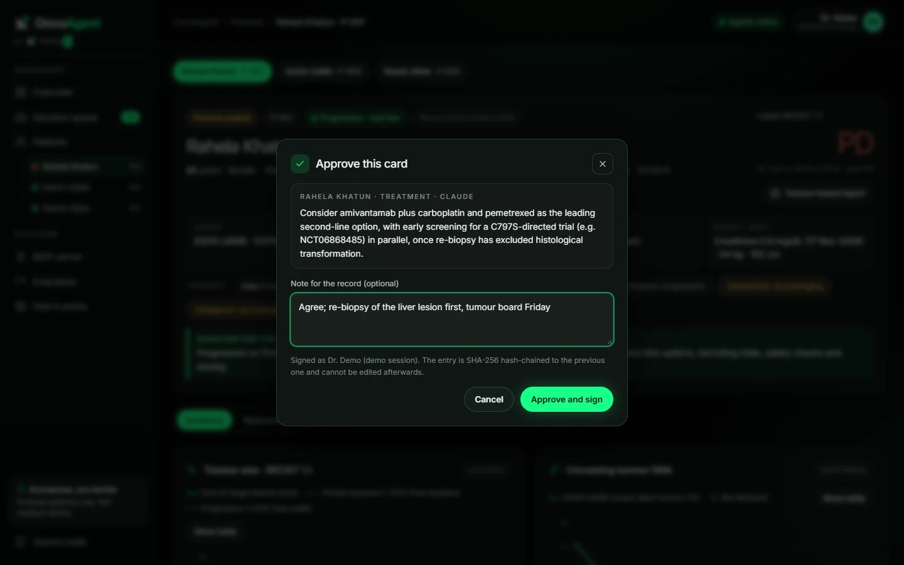 |
| 3D structure insight | 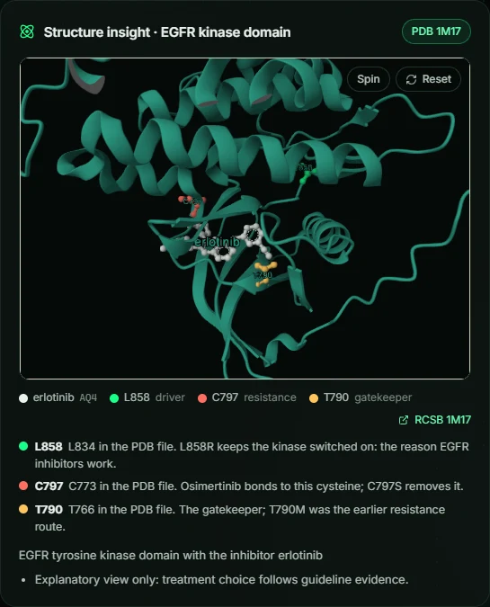 |
| Timeline | 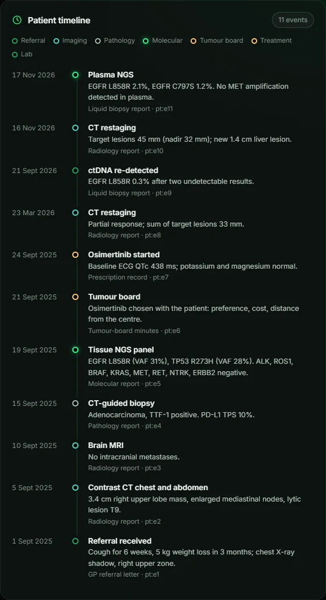 |
| Decision queue | 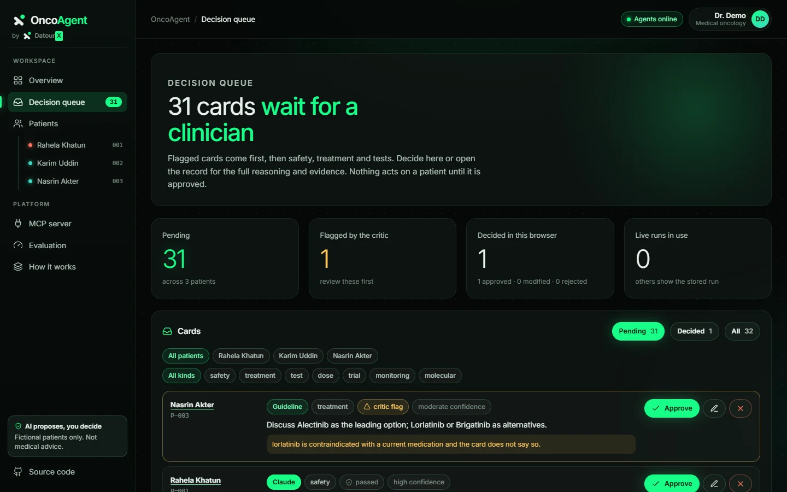 |
| Tumour-board report | 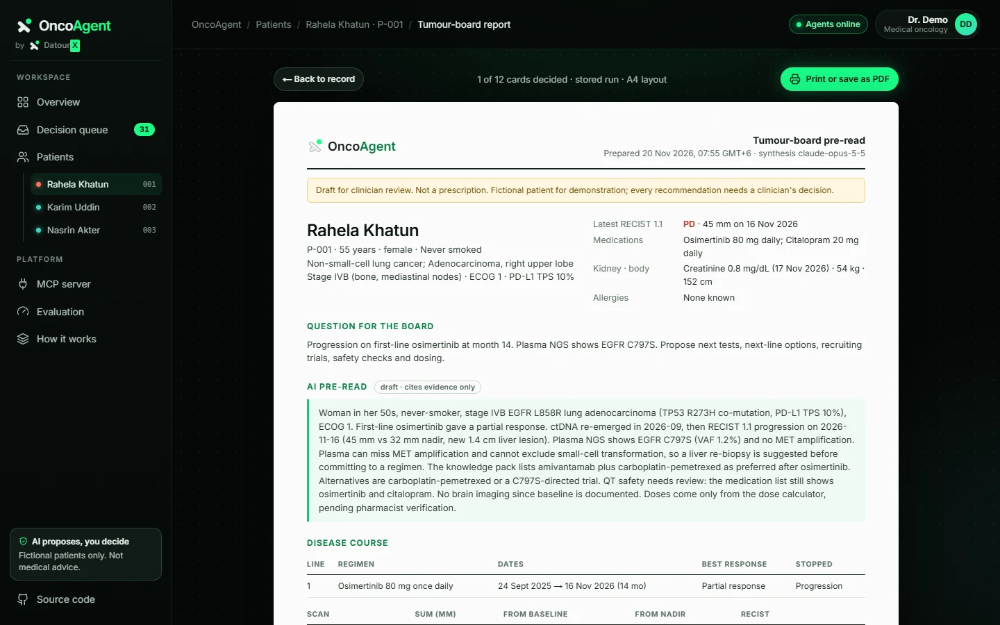 |
| MCP tester | 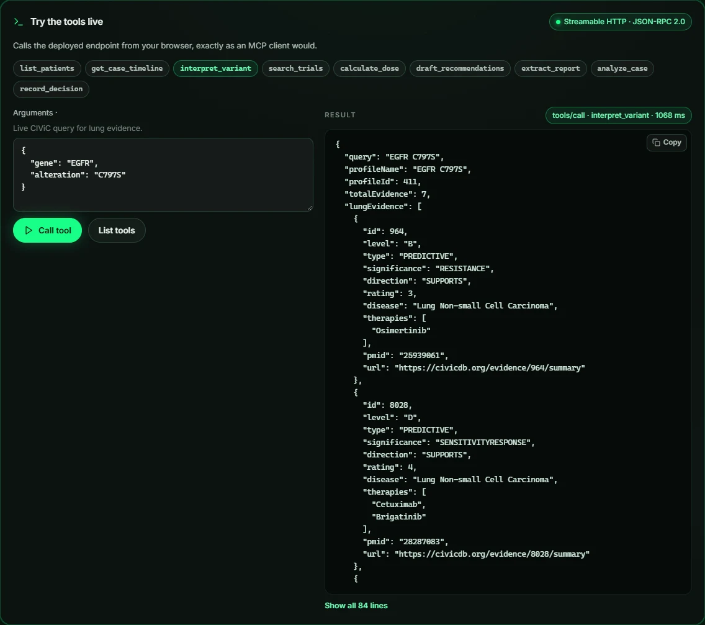 |
| Evaluation | 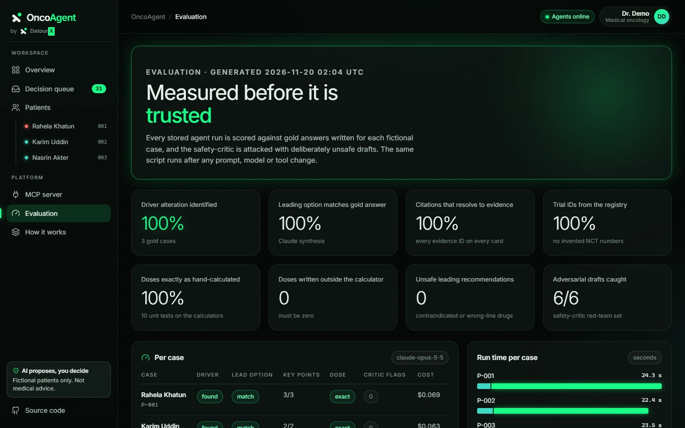 |
| How it works | 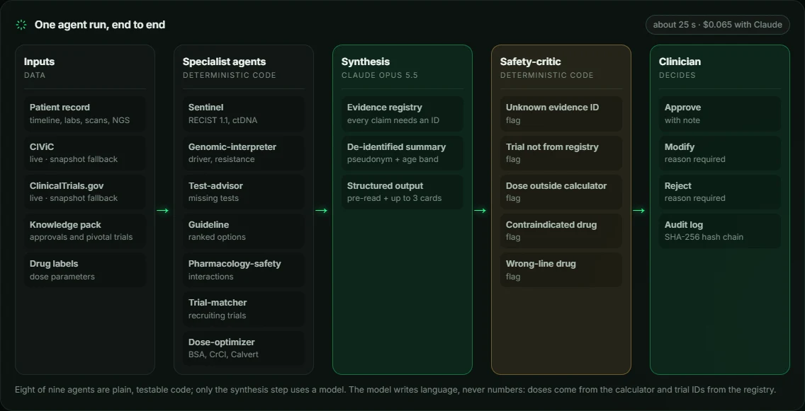 |
| Critic flag | 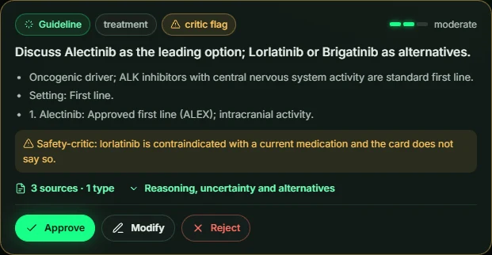 |
| Case intake | 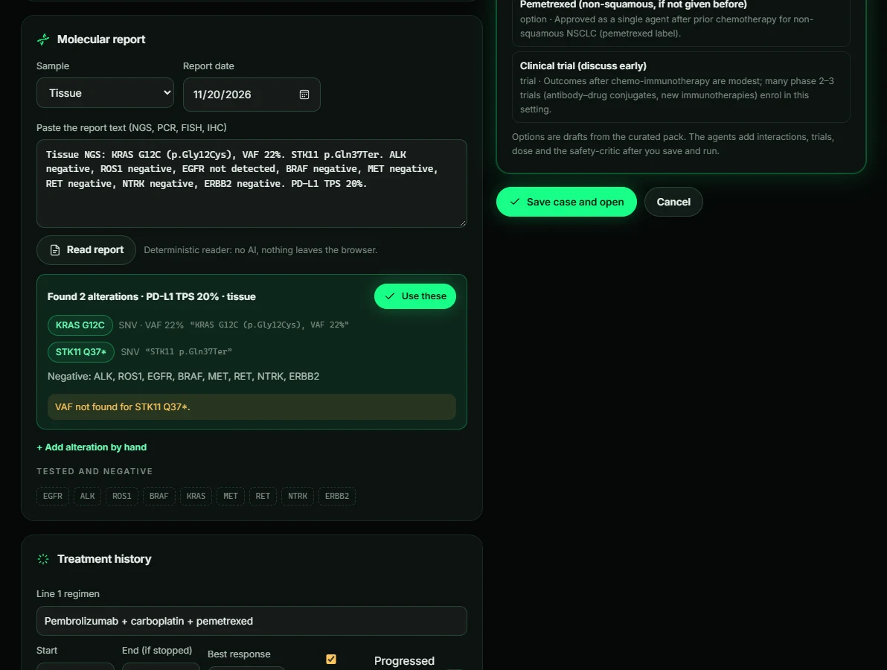 |
| Entered case record | 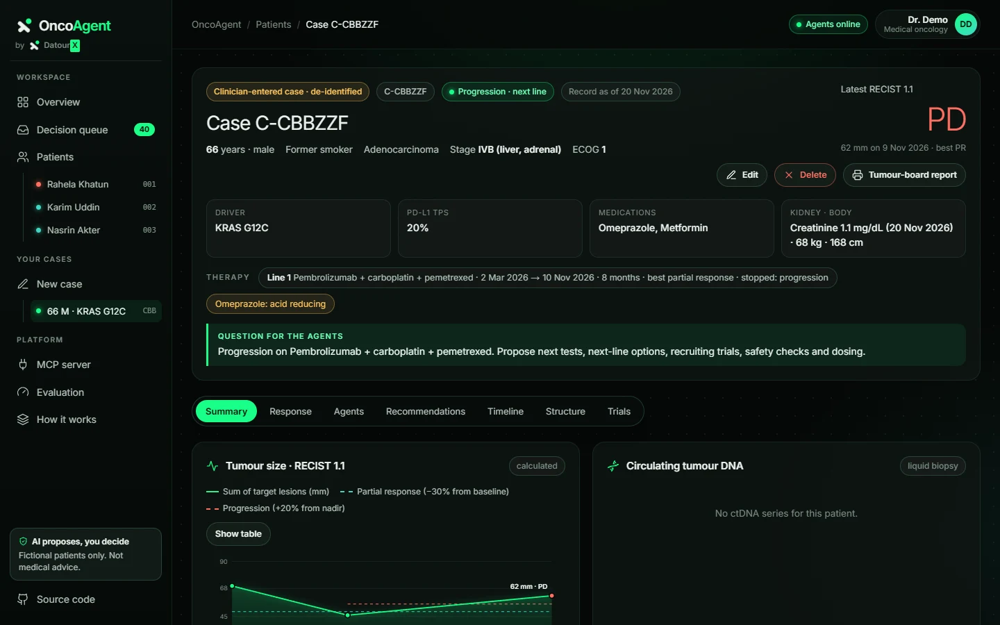 |
| Entered case cards | 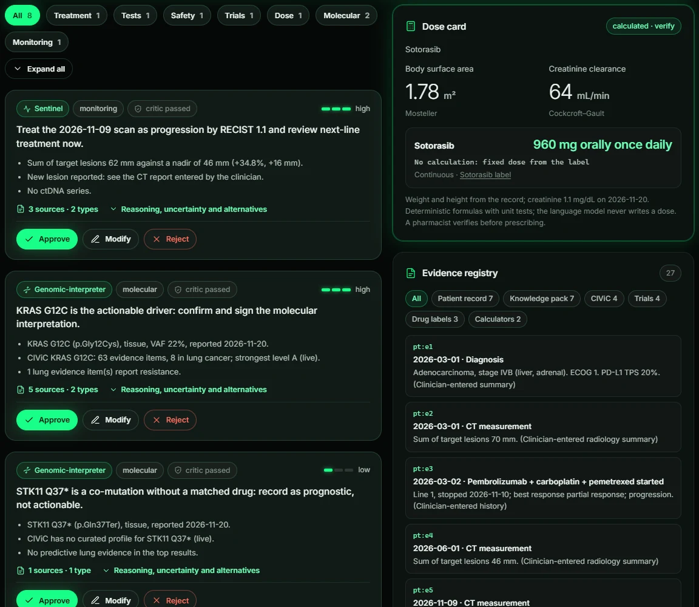 |
