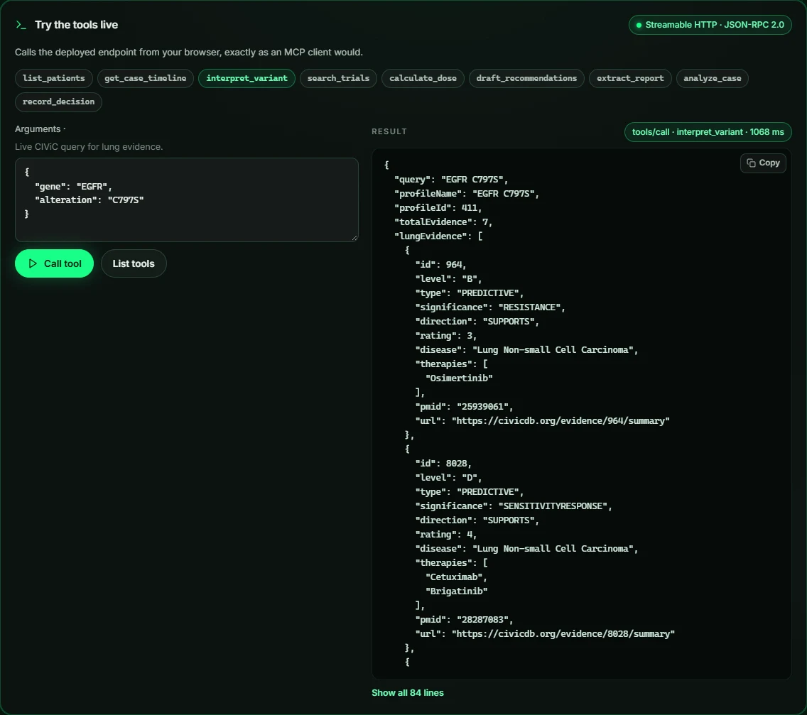

# MCP server: `oncoagent-mcp`

`oncoagent-mcp` version 0.2.0 exposes the platform's tools over the [Model Context Protocol](https://modelcontextprotocol.io), so Claude, IDE agents and hospital systems can call the same variant lookup, trial search, dose calculator, report reader and agent pipeline that the workspace uses.

- Definition: [`registerOncoTools(server)`](../app/src/lib/mcp/tools.ts), `SERVER_INFO = { name: "oncoagent-mcp", version: "0.2.0" }`
- Nine tools: `list_patients`, `get_case_timeline`, `interpret_variant`, `search_trials`, `calculate_dose`, `draft_recommendations`, `extract_report`, `analyze_case`, `record_decision`
- Deployed endpoint: `https://oncoagent.vercel.app/api/mcp` (Streamable HTTP)
- In-browser tester: the `/mcp` page of the workspace

The demo patients behind this server are fictional. `extract_report` and `analyze_case` accept clinician-entered text and cases: send only de-identified or fictional data, and never real patient data to the public endpoint.



## 1. Transports

One tool definition serves both transports, so they cannot drift apart.

| Transport | Entry point | How it starts | Notes |
|---|---|---|---|
| stdio | [mcp/stdio.ts](../app/mcp/stdio.ts) | `serveStdio()` from `@modelcontextprotocol/server/stdio` creates an `McpServer` and calls `registerOncoTools` | Loads `.env.local` (then `../.env.local`) from the working directory, if present. Run with `npm run mcp:stdio` or `npx tsx mcp/stdio.ts` from `app/` |
| Streamable HTTP | [api/mcp/route.ts](../app/src/app/api/mcp/route.ts) | `createMcpHandler()` from `mcp-handler` on a Next.js route; `GET`, `POST` and `DELETE` | `maxDuration = 300` s. Bearer token or signed-in session (below) |

### Authentication on the HTTP endpoint

A request is accepted when it carries `Authorization: Bearer <MCP_BEARER_TOKEN>` (compared in constant time), or when it comes from a signed-in clinician's browser (the in-app tester on `/mcp`). Otherwise the route answers:

```http
HTTP/1.1 401 Unauthorized
content-type: application/json
www-authenticate: Bearer

{"error":"unauthorized"}
```

The endpoint is open when `MCP_PUBLIC=true` (a deliberate choice for a public review: the tools read fictional records and public sources, `record_decision` still needs the clinician token, and Claude runs stay rate-limited), or when no token is set **and** sign-in is off (`AUTH_MODE=off`, local work). Since v0.4 the public demo sets a token, so external clients need it; after signing in, judges can use the in-app tester on `/mcp` without one. Production replaces the shared token with OAuth or hospital SSO ([ROADMAP.md](ROADMAP.md#3-engineering-backlog)).

## 2. Connecting a client

### Claude Code (HTTP)

```bash
claude mcp add --transport http oncoagent https://oncoagent.vercel.app/api/mcp \
  --header "Authorization: Bearer <token>"
```

Without the header the client gets 401. On a local server with `AUTH_MODE=off` and no `MCP_BEARER_TOKEN`, leave it out.

### Claude Desktop (HTTP through `mcp-remote`)

```json
{
  "mcpServers": {
    "oncoagent": {
      "command": "npx",
      "args": ["-y", "mcp-remote", "https://oncoagent.vercel.app/api/mcp", "--header", "Authorization: Bearer <token>"]
    }
  }
}
```

### Local stdio

From the repository:

```bash
cd app
npm install
npx tsx mcp/stdio.ts        # or: npm run mcp:stdio
```

A desktop client that cannot set a working directory should call the `tsx` binary and the script by absolute path, and pass any keys in `env`, because `.env.local` is looked up relative to the working directory:

```json
{
  "mcpServers": {
    "oncoagent-local": {
      "command": "/absolute/path/to/oncoagent/app/node_modules/.bin/tsx",
      "args": ["/absolute/path/to/oncoagent/app/mcp/stdio.ts"],
      "env": { "ANTHROPIC_API_KEY": "<optional>", "CLINICIAN_TOKEN": "<optional>" }
    }
  }
}
```

On Windows the binary is `node_modules\.bin\tsx.cmd`.

### Smoke test

[scripts/mcp-smoke.ts](../app/scripts/mcp-smoke.ts) connects with the MCP client SDK, lists the tools and calls `interpret_variant`, `search_trials`, `calculate_dose` and `record_decision` (without a valid token, to show the refusal).

```bash
cd app
npm run mcp:smoke                                          # stdio
MCP_BEARER_TOKEN=<token> npx tsx scripts/mcp-smoke.ts https://oncoagent.vercel.app/api/mcp   # Streamable HTTP
```

### Raw JSON-RPC over HTTP

Send JSON-RPC 2.0 with `Accept: application/json, text/event-stream` and `Authorization: Bearer <token>`. The deployed handler answers a single `tools/list` or `tools/call` request without a prior `initialize`, which is how the in-browser tester works; standard MCP clients perform the full handshake. The response may arrive as a Server-Sent Events frame (`event: message` and a `data:` line holding the JSON-RPC response); read the last `data:` line.

Each tool returns one `text` content item whose text is JSON (pretty-printed). Errors set `isError: true`. The examples below show the decoded JSON and are trimmed with `…`.

## 3. Tools

| Tool | Reads | Writes | Network | Model cost |
|---|---|---|---|---|
| `list_patients` | Fictional records | — | — | — |
| `get_case_timeline` | Fictional records | — | — | — |
| `interpret_variant` | CIViC | — | CIViC (snapshot fallback) | — |
| `search_trials` | ClinicalTrials.gov | — | ClinicalTrials.gov (snapshot fallback) | — |
| `calculate_dose` | Regimen table | — | — | — |
| `draft_recommendations` | Records, CIViC, trials, knowledge pack | — | CIViC, ClinicalTrials.gov, optionally Claude | Only with `use_claude: true` (rate-limited) |
| `extract_report` | The text you send | — | — | — |
| `analyze_case` | The case you send, CIViC, trials, knowledge pack | — | CIViC, ClinicalTrials.gov, optionally Claude | Only with `use_claude: true` (rate-limited) |
| `record_decision` | — | In-memory decision chain | — | — |

### 3.1 `list_patients`

Lists the fictional NSCLC patients and the clinical question for each.

Input: none (`{}`).

```json
{"jsonrpc":"2.0","id":1,"method":"tools/call","params":{"name":"list_patients","arguments":{}}}
```

```json
[
  {
    "id": "P-001",
    "status": "Progression · next line",
    "stage": "IVB (bone, mediastinal nodes)",
    "drivers": ["EGFR L858R", "TP53 R273H", "EGFR C797S"],
    "question": "Progression on first-line osimertinib at month 14. Plasma NGS shows EGFR C797S. Propose next tests, next-line options, recruiting trials, safety checks and dosing."
  },
  { "id": "P-002", "status": "New diagnosis · first line", "…": "…" },
  { "id": "P-003", "status": "New diagnosis · first line", "…": "…" }
]
```

### 3.2 `get_case_timeline`

Returns a patient's de-identified timeline: age band (not exact age), events, therapy lines, RECIST 1.1 assessments with categories, ctDNA and medications. The display name is not returned.

| Input | Type | Required | Notes |
|---|---|---|---|
| `patient_id` | string | yes | For example `P-001` |

```json
{"jsonrpc":"2.0","id":2,"method":"tools/call","params":{"name":"get_case_timeline","arguments":{"patient_id":"P-001"}}}
```

```json
{
  "id": "P-001",
  "ageBand": "50s",
  "sex": "F",
  "histology": "Adenocarcinoma, right upper lobe",
  "stage": "IVB (bone, mediastinal nodes)",
  "ecog": 1,
  "pdl1Tps": 10,
  "variants": [{ "gene": "EGFR", "alteration": "L858R", "kind": "SNV", "vafPercent": 31, "sample": "tissue", "…": "…" }, "…"],
  "therapyLines": [{ "line": 1, "regimen": "Osimertinib 80 mg once daily", "start": "2025-09-24", "end": "2026-11-16", "…": "…" }],
  "events": [{ "id": "e10", "date": "2026-11-16", "kind": "imaging", "title": "CT restaging", "detail": "Target lesions 45 mm (nadir 32 mm); new 1.4 cm liver lesion.", "source": "Radiology report" }, "…"],
  "recist": [{ "date": "2026-11-16", "sumMm": 45, "nadirMm": 32, "changeFromNadirPct": 40.6, "category": "PD", "…": "…" }, "…"],
  "ctdna": ["…"],
  "medications": [{ "name": "Citalopram 20 mg daily", "tags": ["qt-prolonging"] }, "…"]
}
```

Unknown ID: `isError: true`, text `Unknown patient X. Use list_patients.`

### 3.3 `interpret_variant`

Looks up curated evidence for a tumour alteration in CIViC (CC0). Calls [`interpretVariant()`](../app/src/lib/tools/civic.ts): live GraphQL query with a 12 s timeout, then the committed snapshot, then an empty result with `source: "none"`.

| Input | Type | Required | Notes |
|---|---|---|---|
| `gene` | string | yes | HGNC symbol, for example `EGFR` |
| `alteration` | string | yes | Protein change or fusion, for example `L858R`, `C797S`, `G12C`, `EML4::ALK` |

```json
{"jsonrpc":"2.0","id":3,"method":"tools/call","params":{"name":"interpret_variant","arguments":{"gene":"EGFR","alteration":"C797S"}}}
```

```json
{
  "query": "EGFR C797S",
  "profileName": "EGFR C797S",
  "profileId": 411,
  "totalEvidence": 7,
  "lungEvidence": [
    {
      "id": 964,
      "level": "B",
      "type": "PREDICTIVE",
      "significance": "RESISTANCE",
      "direction": "SUPPORTS",
      "rating": 3,
      "disease": "Lung Non-small Cell Carcinoma",
      "therapies": ["Osimertinib"],
      "pmid": "25939061",
      "url": "https://civicdb.org/evidence/964/summary"
    },
    "…"
  ],
  "source": "live",
  "fetchedAt": "2026-11-20T…Z"
}
```

`lungEvidence` holds at most 8 lung-cancer items, sorted by level (A first) and then rating. Values above are from the committed snapshot; live values may differ.

### 3.4 `search_trials`

Searches ClinicalTrials.gov API v2 for recruiting interventional studies. Calls [`searchTrials()`](../app/src/lib/tools/trials.ts) with the same live-then-snapshot fallback.

| Input | Type | Required | Default | Notes |
|---|---|---|---|---|
| `condition` | string | no | `non-small cell lung cancer` | |
| `biomarker` | string | yes | | For example `EGFR C797S` |
| `max_results` | integer 1 to 20 | no | 6 | Snapshot fallback returns at most what was stored (10) |

```json
{"jsonrpc":"2.0","id":4,"method":"tools/call","params":{"name":"search_trials","arguments":{"biomarker":"EGFR C797S","max_results":3}}}
```

```json
{
  "condition": "non-small cell lung cancer",
  "term": "EGFR C797S",
  "total": 9,
  "trials": [
    {
      "nctId": "NCT05256290",
      "title": "Phase 1/2 Study of Silevertinib (BDTX-1535) in Patients With Glioblastoma or Non-Small Cell Lung Cancer With EGFR Mutations",
      "phases": ["PHASE1", "PHASE2"],
      "status": "RECRUITING",
      "sponsor": "Black Diamond Therapeutics, Inc.",
      "countries": ["United States", "Canada"],
      "startDate": "2022-03-31",
      "url": "https://clinicaltrials.gov/study/NCT05256290",
      "matchNotes": ["Mentions EGFR C797S in title or keywords"]
    },
    "…"
  ],
  "source": "live",
  "fetchedAt": "2026-11-20T…Z"
}
```

`matchNotes` says when the biomarker appears in the title, conditions or keywords, and lists sites in Bangladesh, India, Pakistan, Sri Lanka or Nepal. Eligibility is not checked; the investigator confirms it.

### 3.5 `calculate_dose`

Deterministic, unit-tested dose calculation: Mosteller BSA, Cockcroft–Gault CrCl (×0.85 for women), Calvert carboplatin with GFR capped at 125 mL/min, mg/m², mg/kg, weight bands and fixed label doses, and blocks for stale creatinine (more than 7 days) and for low clearance. Calls [`buildDoseCard()`](../app/src/lib/clinical/dose.ts). Output must be verified by a pharmacist and an oncologist.

| Input | Type | Required | Constraint |
|---|---|---|---|
| `regimen` | enum | yes | One of the 34 keys in [regimens.ts](../app/src/lib/data/regimens.ts), listed in the tool description (for example `carboplatin-pemetrexed`, `selpercatinib`, `trastuzumab-deruxtecan`) |
| `height_cm` | number | yes | > 0 |
| `weight_kg` | number | yes | > 0 |
| `age` | integer | yes | 18 to 110 |
| `sex` | `F` or `M` | yes | |
| `serum_creatinine_mg_dl` | number | yes | > 0 |
| `creatinine_date` | string | yes | ISO date of the creatinine result |
| `today` | string | no | ISO date for the freshness check; defaults to the server's current date |

```json
{"jsonrpc":"2.0","id":5,"method":"tools/call","params":{"name":"calculate_dose","arguments":{
  "regimen":"carboplatin-pemetrexed","height_cm":152,"weight_kg":54,"age":55,"sex":"F",
  "serum_creatinine_mg_dl":0.8,"creatinine_date":"2026-11-17","today":"2026-11-20"}}}
```

```json
{
  "regimenKey": "carboplatin-pemetrexed",
  "regimenName": "Carboplatin + pemetrexed (every 21 days)",
  "bsa": 1.5099668870541498,
  "crcl": 67.734375,
  "lines": [
    {
      "drug": "Carboplatin",
      "method": "Calvert",
      "formula": "Dose = AUC × (GFR + 25) = 5 × (67.7 + 25)",
      "inputs": ["Target AUC 5 mg/mL·min (regimen protocol)", "GFR ≈ CrCl 67.7 mL/min (Cockcroft–Gault)"],
      "raw": 463.671875,
      "rounded": 460,
      "text": "460 mg",
      "schedule": "Day 1, every 21 days",
      "source": "Carboplatin label (Calvert formula; FDA advises capping GFR at 125 mL/min)",
      "url": "https://dailymed.nlm.nih.gov/dailymed/search.cfm?labeltype=all&query=carboplatin"
    },
    {
      "drug": "Pemetrexed",
      "method": "Body surface area",
      "formula": "Dose = 500 mg/m² × 1.51 m²",
      "raw": 754.9834435270749,
      "rounded": 750,
      "text": "750 mg",
      "…": "…"
    }
  ],
  "premedication": ["Folic acid 400–1000 mcg orally once daily, starting 7 days before the first dose (pemetrexed label)", "…"],
  "blocks": [],
  "warnings": [],
  "asOf": "Weight and height from the record; creatinine 0.8 mg/dL on 2026-11-17"
}
```

With `"today": "2026-12-20"` the same call returns `"blocks": ["Creatinine is 33 days old (limit 7). Repeat before dosing."]`. A non-empty `blocks` array means the card must not be used for prescribing until the cause is fixed.

### 3.6 `draft_recommendations`

Runs the full agent pipeline ([`runPipeline()`](../app/src/lib/agents/pipeline.ts)) and the safety-critic for one patient. Every card is a draft: a clinician must approve, modify or reject it.

| Input | Type | Required | Default | Notes |
|---|---|---|---|---|
| `patient_id` | string | yes | | `P-001`, `P-002` or `P-003` |
| `use_claude` | boolean | no | `false` | Adds the Claude synthesis step; needs `ANTHROPIC_API_KEY` on the server |

```json
{"jsonrpc":"2.0","id":6,"method":"tools/call","params":{"name":"draft_recommendations","arguments":{"patient_id":"P-003","use_claude":false}}}
```

```json
{
  "patientId": "P-003",
  "mode": "rules-only",
  "boardSummary": "P-003: 45-year-old woman, adenocarcinoma, right middle lobe, stage IVB (brain, pleura). ALK EML4::ALK. … Leading option from the knowledge pack: Alectinib.",
  "cards": [
    {
      "id": "P-003-guideline-…",
      "agent": "Guideline",
      "kind": "treatment",
      "proposal": "Discuss Alectinib as the leading option; Brigatinib (avoid with current strong cyp3a inducer) or Lorlatinib (contraindicated with current strong cyp3a inducer) as alternatives.",
      "evidenceIds": ["kb:alk1-alectinib", "kb:alk1-lorlatinib", "kb:alk1-brigatinib", "label:lorlatinib:strong-cyp3a-inducer:g0", "label:brigatinib:strong-cyp3a-inducer:g1"],
      "confidence": "moderate",
      "critic": { "verdict": "pass", "notes": [] }
    },
    {
      "id": "P-003-pharmacology-safety-…",
      "agent": "Pharmacology-safety",
      "kind": "safety",
      "proposal": "Before choosing a drug, ask neurology to replace carbamazepine (strong CYP3A inducer) with a non-inducing alternative; lorlatinib is contraindicated while it continues.",
      "evidenceIds": ["label:lorlatinib:strong-cyp3a-inducer:0", "label:brigatinib:strong-cyp3a-inducer:1", "label:alectinib:strong-cyp3a-inducer:2"],
      "confidence": "high",
      "critic": { "verdict": "pass", "notes": [] }
    },
    "…"
  ],
  "evidence": [{ "id": "pt:e1", "label": "2026-10-25 · Seizure" }, { "id": "civic:EID…", "label": "CIViC EID… · level …", "url": "https://civicdb.org/evidence/…/summary" }, "…"],
  "dose": { "regimenKey": "alectinib", "lines": [{ "drug": "Alectinib", "text": "600 mg orally twice daily with food", "…": "…" }], "blocks": [], "…": "…" }
}
```

Side effects: outbound calls to CIViC and ClinicalTrials.gov, and to Claude when `use_claude` is true. Nothing is written to any record or log.

Rate limit: Claude synthesis through MCP is limited to **10 runs per hour** (`MCP_CLAUDE_RUNS_PER_HOUR` in [ratelimit.ts](../app/src/lib/ratelimit.ts)), shared by `draft_recommendations` and `analyze_case`. The counter is shared by all MCP callers of one server instance, kept in memory, and counts every `use_claude: true` call. Over the limit the call does not fail: it runs rules-only and adds

```json
"note": "Claude synthesis is limited to 10 runs per hour on the public endpoint; this run used the rules-only agents."
```

Card IDs are generated per run. Pass a card ID from the same run to `record_decision`.

### 3.7 `extract_report`

Reads pasted molecular-report text deterministically and returns the alterations it found, each with the exact text that matched. Calls [`extractReport()`](../app/src/lib/clinical/extract.ts), the same reader the intake form runs in the browser (rules only, no language model). A clinician must confirm the result. What it recognises and how it stays conservative: [DATA.md](DATA.md#33-report-reader).

| Input | Type | Required | Constraint |
|---|---|---|---|
| `text` | string | yes | 3 to 12,000 characters. Remove patient identifiers first |

```json
{"jsonrpc":"2.0","id":7,"method":"tools/call","params":{"name":"extract_report","arguments":{
  "text":"Tissue NGS: KRAS G12C (p.Gly12Cys), VAF 22%. STK11 p.Gln37Ter. ALK negative, ROS1 negative, EGFR not detected, BRAF negative, MET negative, RET negative, NTRK negative, ERBB2 negative. PD-L1 TPS 20%."}}}
```

```json
{
  "variants": [
    { "gene": "KRAS", "alteration": "G12C", "kind": "SNV", "matched": "KRAS G12C (p.Gly12Cys), VAF 22%", "hgvsP": "p.Gly12Cys", "vafPercent": 22 },
    { "gene": "STK11", "alteration": "Q37*", "kind": "SNV", "matched": "STK11 p.Gln37Ter", "hgvsP": "p.Gln37Ter" }
  ],
  "testedNegative": ["ALK", "ROS1", "EGFR", "BRAF", "MET", "RET", "NTRK", "ERBB2"],
  "warnings": ["VAF not found for STK11 Q37*."],
  "pdl1Tps": 20,
  "sample": "tissue"
}
```

Side effects: none. The text is processed in memory and not stored. Unlike the intake form, where the text never leaves the browser, this tool sends the text to the server, so callers must remove identifiers first.

### 3.8 `analyze_case`

Runs the nine agents on a clinician-entered, de-identified NSCLC case and returns draft cards with evidence IDs, the knowledge-pack setting and its reason, the dose card and the critic verdicts. The input is validated by the same `CaseInputSchema` as the workspace; the server rebuilds the record with `buildPatientFromInput()` and stores nothing.

| Input | Type | Required | Default | Notes |
|---|---|---|---|---|
| `case_id` | string | no | generated | Used when it matches `C-` plus 6 characters (`C-7K2M9Q`); otherwise a new ID is generated |
| `case` | `CaseInput` | yes | | All fields and limits in [DATA.md](DATA.md#31-caseinput). Required: `age`, `sex`, `smoking`, `histology`, `stage`, `ecog`, `weightKg`, `heightCm`, `creatinineMgDl`, `creatinineDate`, `reportDate`, `variants`, `testedNegative`, `priorLines`, `medications`, `recist`, `asOf` (arrays may be empty) |
| `use_claude` | boolean | no | `false` | Adds the Claude synthesis step; rate-limited (below) |

```json
{"jsonrpc":"2.0","id":8,"method":"tools/call","params":{"name":"analyze_case","arguments":{"case":{
  "age":66,"sex":"M","smoking":"former","histology":"adenocarcinoma","stage":"IVB","sites":"liver, adrenal","ecog":1,"pdl1Tps":20,
  "weightKg":68,"heightCm":168,"creatinineMgDl":1.1,"creatinineDate":"2026-11-18","reportDate":"2026-11-12",
  "variants":[{"gene":"KRAS","alteration":"G12C","kind":"SNV","vafPercent":22,"sample":"tissue"},{"gene":"STK11","alteration":"Q37*","kind":"SNV","sample":"tissue"}],
  "testedNegative":["ALK","ROS1","EGFR","BRAF","MET","RET","NTRK","ERBB2"],
  "priorLines":[{"regimen":"Pembrolizumab + carboplatin + pemetrexed","start":"2026-03-02","end":"2026-11-10","bestResponse":"Partial response","progressed":true}],
  "medications":["Omeprazole 20 mg daily","Metformin 500 mg twice daily"],
  "recist":[{"date":"2026-03-01","sumMm":70,"newLesions":false},{"date":"2026-06-01","sumMm":46,"newLesions":false},{"date":"2026-11-09","sumMm":62,"newLesions":true}],
  "asOf":"2026-11-20"},"use_claude":false}}}
```

```json
{
  "caseId": "C-…",
  "setting": "KRAS_G12C_POST",
  "settingReason": "KRAS G12C: at least one prior systemic therapy has failed, so the post-therapy entry applies (G12C inhibitors are approved after prior systemic therapy). Co-mutation(s) STK11 Q37* do not change the pathway.",
  "mode": "rules-only",
  "boardSummary": "…",
  "cards": [
    { "agent": "Sentinel", "kind": "monitoring", "proposal": "Treat the 2026-11-09 scan as progression by RECIST 1.1 and review next-line treatment now.", "critic": { "verdict": "pass", "notes": [] }, "…": "…" },
    { "agent": "Guideline", "kind": "treatment", "proposal": "Discuss Sotorasib (avoid with current acid reducing) as the leading option; Adagrasib or Docetaxel or Clinical trial of a next-generation KRAS G12C inhibitor or combination as alternatives.", "…": "…" },
    { "agent": "Pharmacology-safety", "kind": "safety", "proposal": "Review omeprazole (acid-reducing) before starting sotorasib: absorption falls; follow the label's timing advice.", "…": "…" },
    { "agent": "Dose-optimizer", "kind": "dose", "proposal": "Dose card ready for Sotorasib: Sotorasib 960 mg orally once daily. Pharmacist and oncologist to verify.", "…": "…" },
    "…"
  ],
  "evidence": ["…"],
  "dose": { "regimenKey": "sotorasib", "lines": [{ "drug": "Sotorasib", "method": "Fixed dose", "text": "960 mg orally once daily", "…": "…" }], "blocks": [], "…": "…" }
}
```

When the pack does not cover the setting, `setting` is `null`, `settingReason` explains why (for example "Not covered by the knowledge pack: EGFR G719A is an uncommon EGFR alteration …"), the Guideline card proposes tumour-board discussion instead of a treatment, and there is no dose card.

An invalid `case` fails the tool's input-schema validation and the call returns a validation error; the agents do not run. Side effects: outbound calls to CIViC and ClinicalTrials.gov, and to Claude when `use_claude` is true. Nothing is stored.

### 3.9 `record_decision`

Signs a clinician decision on a card into a SHA-256 hash-chained log. An AI client cannot sign on its own.

| Input | Type | Required | Constraint |
|---|---|---|---|
| `patient_id` | string | yes | |
| `card_id` | string | yes | |
| `action` | enum | yes | `approve`, `modify`, `reject` |
| `reason` | string | yes | At least 5 characters (the schema requires it for every action) |
| `clinician_token` | string | yes | Must equal the server's `CLINICIAN_TOKEN` |

Token rule: the tool refuses when `CLINICIAN_TOKEN` is not set on the server, or when the supplied token does not match it. The public demo does not set it, so every call is refused there.

```json
{"jsonrpc":"2.0","id":7,"method":"tools/call","params":{"name":"record_decision","arguments":{
  "patient_id":"P-001","card_id":"demo-card","action":"approve","reason":"Agree with the plan","clinician_token":"not-a-clinician"}}}
```

```json
{
  "content": [{ "type": "text", "text": "Refused: decisions can only be signed with a valid clinician session token. The AI proposes; a clinician decides." }],
  "isError": true
}
```

With a valid token the tool returns the new entry:

```json
{
  "seq": 1,
  "at": "2026-11-20T…Z",
  "cardId": "P-001-claude-…-0",
  "patientId": "P-001",
  "action": "approve",
  "reason": "Agree; re-biopsy first",
  "prevHash": "0000000000000000000000000000000000000000000000000000000000000000",
  "hash": "…64 hex characters…"
}
```

`hash` is SHA-256 of the JSON of the entry without `hash`; `prevHash` is the previous entry's hash (64 zeros for the first). The chain lives in the memory of one server process or function instance and is lost when it restarts. It is separate from the browser audit log of the web workspace. The tool does not check that `card_id` exists or belongs to the patient. A persistent, shared, identity-bound log is planned ([ROADMAP.md](ROADMAP.md#3-engineering-backlog)).

## 4. Safety on the tool layer

- Read tools return data with sources; none of them changes a patient record.
- `record_decision` is the only write, and it needs a clinician token. A model calling the tools cannot sign.
- `draft_recommendations` and `analyze_case` return drafts with critic verdicts; a flagged card says why. Neither stores anything.
- `extract_report` is deterministic and returns the matched text for every finding, so a clinician can check it; it never invents a variant.
- Tool outputs are data, not instructions: the synthesis prompt treats evidence as quoted facts, and clients should do the same.
- Claude runs are rate-limited; rules-only runs and the other tools are not.
- The public endpoint is for fictional or de-identified data only; nothing detects identifiers in submitted text yet. For a hospital pilot the server would run inside the hospital network (on-premises or an outbound-only tunnel), behind SSO.

More: [SAFETY.md](SAFETY.md), [API.md](API.md).
