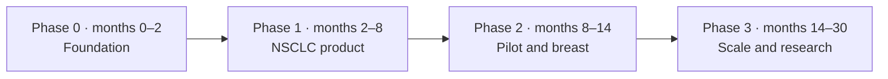

# Roadmap

Phases with exit criteria, where the MVP stands today, and the engineering backlog derived from the current code. Months count from 20 November 2026. This is a plan, not a record of traction.

## 1. Phases

| Phase | Months | Deliverables | Exit criteria |
|---|---|---|---|
| 0 Foundation | 0–2 | Harden the MVP: authentication, server-side case, run and audit store, identifier detection, CI with an evaluation gate; expand the fictional gold cases; hazard log reviewed by clinical safety; regulatory classification memo; data-protection assessment | CI blocks a release on any regression; zero open high-severity hazards without a control; classification memo signed off |
| 1 NSCLC product | 2–8 | Full NSCLC agent set: PDF report upload (text paste is done), guideline retrieval with versioned sources, FHIR R4 / mCODE ingestion, imaging report parsing, licensed interaction database, report-writer, Bangla interface; usability study with oncologists | ≥ 90% concordance on NSCLC gold cases, 0 contraindication misses, 0 dose-calculation errors, usability target met |
| 2 Pilot and breast | 8–14 | Ethics approval; integration with a partner hospital (FHIR / HL7, PACS); in-country hosting; silent-mode study on real cases ([EVALUATION.md](EVALUATION.md#8-pilot-evaluation-plan-planned)); breast cancer knowledge pack and gold cases | Silent-mode safety and concordance report; go or no-go decision for assisted use |
| 3 Scale and research | 14–30 | Assisted-mode pilot with human sign-off; colorectal pack; de-identified research zone (OMOP); target dossiers and an Analog Lab with a licensed discovery partner; regulatory submission for any device parts | Pilot outcomes published; partner agreement in place; regulatory pathway confirmed |

Order of cancers: NSCLC, then breast, then colorectal. A new cancer means a knowledge pack, regimens, a biomarker panel, gold cases and clinical rules, not new agent code.

## 2. Where the MVP stands

Status at v0.3.0 (20 November 2026).

| Deliverable | Status | Evidence |
|---|---|---|
| Fictional NSCLC patients flowing end to end | Done (3 demo patients) | [patients.ts](../app/src/lib/data/patients.ts) |
| Clinician case intake with a deterministic report reader | Done (v0.3): form, pasted-text reader, setting selector, browser storage, server-side validation | [DATA.md](DATA.md#3-clinician-entered-cases) |
| Knowledge pack beyond the demo | Done for 20 NSCLC settings, 34 regimens, 54 interaction rules, 59-medicine catalogue | [knowledge.ts](../app/src/lib/data/knowledge.ts) |
| Nine agents with recommendation cards | Done | [AGENTS.md](AGENTS.md) |
| Unit tests | 167 (case input and critic 11, calculators and RECIST 10, report reader 81, knowledge pack and selector 65) | [EVALUATION.md](EVALUATION.md#1-what-is-evaluated) |
| Evaluation harness and adversarial set | Done, run by hand; stored runs predate the v0.3 agent changes | [EVALUATION.md](EVALUATION.md) |
| Hash-chained sign-off, override reason for flagged cards | Done in the browser | [audit.ts](../app/src/lib/audit.ts), [DecisionDialog.tsx](../app/src/components/DecisionDialog.tsx) |
| MCP server (stdio and HTTP), nine tools | Done | [MCP.md](MCP.md) |
| Hazard log | Second version (20 hazards) | [SAFETY.md](SAFETY.md#3-hazard-log) |
| Server-side case, run and audit store; authentication; CI gate | Not started | Backlog items 1 to 3 |
| PDF upload, guideline retrieval, FHIR ingestion | Not started (text paste is done) | Backlog items 4 to 6 |
| Regulatory classification memo | Not started | [SAFETY.md](SAFETY.md#6-regulatory-position) |

## 3. Engineering backlog

Derived from the code as it is today. Each item names the current behaviour that motivates it.

| # | Item | Today in the code | First step | Phase |
|---|---|---|---|---|
| 1 | Server-side case, run and audit store | Entered cases, live runs and the audit log live in browser `localStorage` ([cases.ts](../app/src/lib/cases.ts), [runs.ts](../app/src/lib/runs.ts), [audit.ts](../app/src/lib/audit.ts)); MCP decisions in process memory ([tools.ts](../app/src/lib/mcp/tools.ts)) | PostgreSQL tables for cases, `agent_run` and an append-only `audit_log` with the same hash chain, inside the hospital network; one API for the web app, `analyze_case` and `record_decision` | 0 |
| 2 | Authentication and roles | Every decision is signed as "Dr. Demo"; MCP uses shared tokens compared with `!==` | OIDC SSO with MFA; roles for oncologist, pharmacist, pathologist; OAuth for MCP; constant-time token checks | 0 |
| 3 | CI with an evaluation gate | `npm test` and `npm run eval` are run by hand (the eval now reads the test count from Vitest) | GitHub Actions: type check, lint, `npm test`, `npm run eval`; fail on any metric drop; regenerate stored runs when agents change | 0 |
| 4 | PDF report upload | Report text must be pasted ([extract.ts](../app/src/lib/clinical/extract.ts)) | Text extraction from text-based PDFs in the browser, feeding the same deterministic reader; then scanned reports with a clinician-confirmed extraction step | 1 |
| 5 | Guideline retrieval | The knowledge pack is a hand-written summary ([knowledge.ts](../app/src/lib/data/knowledge.ts)) | Versioned guideline and label retrieval with citations to section level, under the right licences; pack entries become reviewed records | 1 |
| 6 | FHIR R4 / mCODE ingestion | Records are TypeScript objects or typed case input ([caseInput.ts](../app/src/lib/caseInput.ts)) | Map `CaseInput` and `Patient` to mCODE profiles; ingest from a HAPI FHIR test server with Synthea data | 1 |
| 7 | Identifier detection in free text | The form warns against identifiers; nothing detects them in the label, sites, regimen, medication, question or `extract_report` text | Pattern and name checks before saving and before any model call, with a clear block message | 0 |
| 8 | Blocked dose amounts withheld everywhere | The dose panel shows "withheld", but the printed report, the formula line (`= 463.7 mg`) and the card's reasons still show amounts ([AgentWorkspace.tsx](../app/src/components/AgentWorkspace.tsx), [ReportView.tsx](../app/src/components/ReportView.tsx), [rules.ts](../app/src/lib/agents/rules.ts)) | Omit amounts from all three when `blocks` is non-empty; add a test | 0 |
| 9 | Regenerate stored runs | The three stored runs were made before the v0.3 agent changes | `npm run precompute`, `npm run eval`, update the evaluation page and docs | 0 |
| 10 | Critic hardening and adversarial set | String matching on `proposal` ([critic.ts](../app/src/lib/agents/critic.ts)); check 8 has no adversarial case | Check doses in `why` and `alternatives`; structured drug extraction; "contraindicated" tied to the right drug; adversarial cases for check 8 and for prompt injection in case text | 1 |
| 11 | Case schema tests | `CaseInputSchema` and `buildPatientFromInput()` have no dedicated unit tests | Tests for limits, date validation, timeline building and the default question | 0 |
| 12 | De-identification gateway | Dates and free text reach the model as written ([claude.ts](../app/src/lib/agents/claude.ts)) | Date shifting per patient, free-text scrubbing, an allow-list of fields, tests that fail on any identifier | 1, before any real data |
| 13 | Bangla interface | UI is English only (`lang="en"`); dates formatted for `Asia/Dhaka` ([format.ts](../app/src/lib/format.ts)) | Message catalogue for labels and summaries (en and bn); clinical terms stay in standard form (HGVS, INN drug names) | 1 |
| 14 | Breast and colorectal packs | One cancer type; `NSCLC_PANEL`, selector rules and 20 NSCLC entries | Per-cancer panel, selector, knowledge pack, regimens and gold cases loaded by cancer type | 2 and 3 |
| 15 | OpenTelemetry tracing | Runs record step times and token usage only | Trace each run and agent step, external calls and model calls (model ID, prompt version, tokens, cache reads), with no patient data in spans | 1 |
| 16 | Dated snapshots | Cache files store no fetch date and cover the demo patients only ([civic.ts](../app/src/lib/tools/civic.ts), [trials.ts](../app/src/lib/tools/trials.ts)) | Store `fetchedAt` per entry; show it on the card; scheduled refresh; optional server-side cache for frequent case queries | 0 |
| 17 | Shared rate limiting | In-memory counters per function instance ([ratelimit.ts](../app/src/lib/ratelimit.ts)) | Shared store (for example Redis) with per-clinician and per-client quotas | 0 |
| 18 | Licensed interaction database | 54 label-level rules and a 59-medicine catalogue; unknown medicine names get no tags | Integrate a licensed database; keep the label-rule format for evidence IDs | 1 |
| 19 | Align the P-001 demo entry | Its leading option names amivantamab but maps to the chemotherapy-only regimen | Map it to `amivantamab-carboplatin-pemetrexed` (weight band) and update the gold dose and stored run | 0 |
| 20 | Trial eligibility | Matching by biomarker term ([trials.ts](../app/src/lib/tools/trials.ts)) | Parse eligibility criteria per criterion against structured case data; distance to sites | 1 |
| 21 | Setting confirmation | The selector's choice is shown in the preview but not confirmed explicitly | Ask the clinician to confirm the setting before the run and record it in the audit log | 1 |
| 22 | Prompt-caching verification | System block is marked for caching but is likely below the minimum cacheable length; cache reads are not recorded | Log `usage.cache_read_input_tokens`; move stable content into the cached prefix if it pays off | 1 |
| 23 | Accessibility follow-ups | Dialogs do not trap focus; Mol* spin ignores reduced motion; the medication list has no arrow-key navigation | Focus trap in `DecisionDialog` and the evidence drawer; start Mol* without spin under reduced motion; listbox keyboard pattern | 0 |
| 24 | Content Security Policy | Only basic security headers ([next.config.ts](../app/next.config.ts)) | CSP and HSTS; self-host or pin Mol* with integrity checks | 1 |
| 25 | API versioning | Routes have no version prefix | `/api/v1/…` with OpenAPI and JSON Schemas for the case, card and run types | 1 |

Done in v0.3 (removed from this list): override reason for flagged cards, weight-band and per-kg dosing, interaction context in the Guideline agent, the unit-test count read from Vitest, and pasted-text report reading.

## 4. Open decisions

1. First market and first hospital partner (Bangladesh recommended); this drives regulation, hosting and language.
2. Budget and team: practising oncologists and pathologists must join before any pilot.
3. Level 3 discovery partner: industry partnership or an academic medicinal-chemistry lab.
