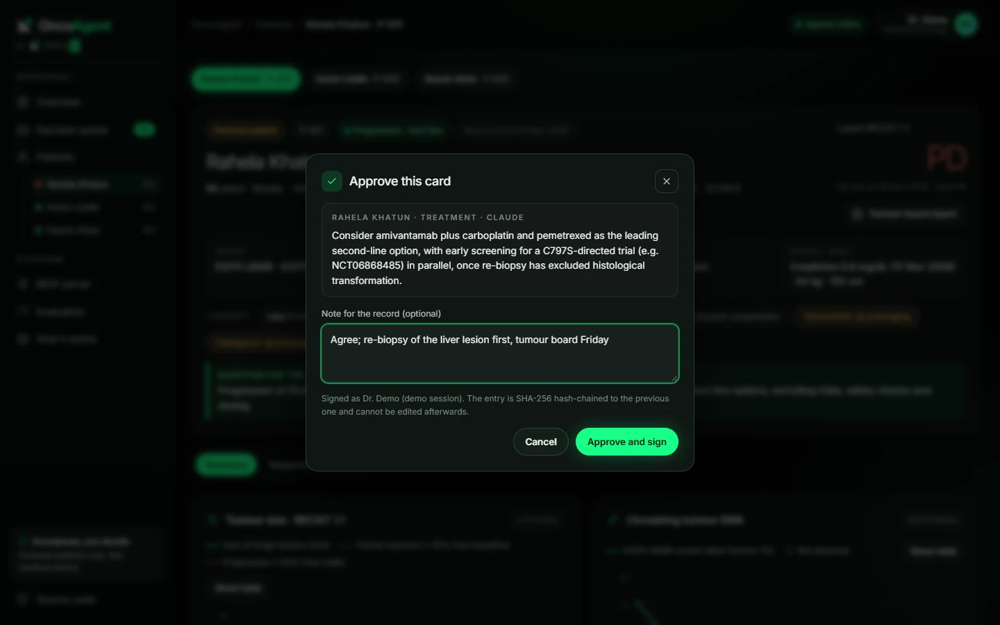

# Clinical safety and governance

Intended use, human-in-the-loop rules, the hazard log, privacy, the research-track boundary and the regulatory position. Each control is marked **Implemented** (in the code today, with a link) or **Planned**.

> OncoAgent is a research prototype. The demo patients are fictional, and cases entered through the intake form must be de-identified or fictional. It is not a medical device, it has no regulatory clearance, and nothing it shows is medical advice. It must not be used with real patient data before ethics approval and a regulatory assessment.

## 1. Intended use

| | |
|---|---|
| Intended users | Oncologists and clinical staff: medical oncologists, molecular pathologists, oncology pharmacists, tumour-board members, trial investigators, oncology nurses in a clinical role |
| Intended use | Prepare and support a clinician's decision about non-small-cell lung cancer: response assessment, missing biomarkers, interpretation of reported alterations, guideline options, interactions, recruiting trials, label-based dose calculation, tumour-board pre-read. Input is a demo record or a de-identified case entered by a clinician, with molecular report text read by a deterministic reader and confirmed by the clinician |
| Output | Recommendation cards and a pre-read for the clinician, each with its evidence. Every card waits for a clinician to approve, modify or reject it |
| Setting | Outpatient oncology and tumour boards, with time to review |

Not intended for:

- Patients or the public. There is no patient app and no patient-facing message.
- Autonomous action. No agent can sign, prescribe, order or contact a patient.
- Emergencies or time-critical alerts.
- Prescribing without pharmacist and oncologist verification of the dose card.
- Cancers other than NSCLC, or patients under 18 (the case form and `calculate_dose` reject ages below 18).
- Identifiable information in any case field: no names, hospital or record numbers, phone numbers, addresses or dates of birth, including in free-text fields and the case label.
- Real patient data before ethics approval, a data-protection assessment and in-country hosting.
- Research-track (Level 3) outputs for patient care, at any time.

## 2. Human in the loop

| Rule | Status | Where |
|---|---|---|
| Every agent output is a card that waits for a clinician decision | Implemented | [AgentWorkspace.tsx](../app/src/components/AgentWorkspace.tsx), [QueueView.tsx](../app/src/components/QueueView.tsx) |
| Approve, modify or reject; modify and reject need a reason code and at least 5 characters of text | Implemented | [DecisionDialog.tsx](../app/src/components/DecisionDialog.tsx) |
| Every decision and every live run is written to a SHA-256 hash chain, and the chain is verified on load ("hash chain intact" or "chain broken") | Implemented (in the browser) | [audit.ts](../app/src/lib/audit.ts) |
| An AI client cannot sign: `record_decision` over MCP needs a clinician token | Implemented | [tools.ts](../app/src/lib/mcp/tools.ts) |
| Each card shows confidence with its reason, what is uncertain, alternatives, what would change the advice, and its evidence | Implemented | [types.ts](../app/src/lib/types.ts) |
| AI-drafted content is labelled (Claude chip, "AI draft", "Draft for clinician review. Not a prescription." on the report) | Implemented | [ReportView.tsx](../app/src/components/ReportView.tsx) |
| Safety-critic flags are shown on the card and sorted first in the queue | Implemented | [critic.ts](../app/src/lib/agents/critic.ts) |
| Approving a flagged card needs an explicit acknowledgement ("I have reviewed this flag and take responsibility for approving the card") and a reason of at least 5 characters; the audit entry records "Approved despite safety-critic flag" | Implemented | [DecisionDialog.tsx](../app/src/components/DecisionDialog.tsx) |
| A blocked dose card withholds the dose amounts | Partly implemented: the dose panel shows "withheld"; the printed report, the formula line and the card's reasons still show the calculated values | [AgentWorkspace.tsx](../app/src/components/AgentWorkspace.tsx) |
| Extracted report findings are proposals: the clinician presses "Use these" and checks each field before saving | Implemented | [CaseForm.tsx](../app/src/components/CaseForm.tsx) |
| Signed-in clinician identity on every decision | Implemented (v0.4): sign-in on every page and API; the audit signer is the session user, set on the server. SSO with MFA and roles is planned | [proxy.ts](../app/src/proxy.ts), [audit route](../app/src/app/api/audit/route.ts) |
| Dose cards need pharmacist and oncologist sign-off as separate roles | Planned (stated on the card and report signature lines today) | — |
| Server-side, append-only audit store | Implemented (v0.4) when `DATABASE_URL` is set: per account, SHA-256 chained, `UPDATE` and `DELETE` refused by a database trigger. The public demo runs in browser mode | [store.ts](../app/src/lib/server/store.ts) |

## 3. Hazard log

Severity assumes real clinical use. Verification refers to [EVALUATION.md](EVALUATION.md) and [clinical.test.ts](../app/src/lib/clinical/clinical.test.ts).

| ID | Hazard | Cause | Control in the MVP | Verification | Planned |
|---|---|---|---|---|---|
| H1 | Hallucinated trial, drug, dose or citation | Language model writes from memory | Model receives only the evidence list and must cite its IDs; prompt forbids doses, invented drugs and NCT IDs, and naming a treatment when no pack option exists; output schema cannot create `dose` or `trial` cards; critic checks 1 to 6 and 8 flag missing or unknown evidence, unregistered NCT IDs, doses in proposals, drugs outside the pack and drug names in an uncovered setting. **Implemented** | Adversarial drafts 1, 2, 3 and 6 caught; 126/126 citations resolve; 21/21 trial IDs from the registry; 0 doses outside the calculator | Check `why` and `alternatives` for doses; structured drug extraction; claim-level verification |
| H2 | Dosing on stale lab data | Old creatinine; old evidence snapshots | Creatinine older than 7 days blocks any regimen that needs renal function, and the dose panel then shows "withheld" instead of amounts; the dose card states the creatinine value and date; weight-based lines ask to confirm the weight is current; live sources are tried first and a snapshot is labelled "snapshot". **Implemented** | Unit test "blocks a dose card when creatinine is stale" | Withhold amounts in the report, formula line and card reasons too; freshness rules for liver tests, blood counts and weight; record the fetch date inside snapshot files |
| H3 | Contraindicated drug proposed | Interaction not detected or not stated | 54 label-based rules and a 59-medicine catalogue with tags; the Guideline agent names interactions on each option and moves a contraindicated option to the end; the Dose-optimizer doses a non-contraindicated option first; the Pharmacology-safety agent names the problem; critic check 7 flags a contraindicated drug named without the word "contraindicated"; contraindications are recomputed from current medications on every run. **Implemented** | Adversarial draft 5 caught; P-003 rules card flagged in the stored run (before the Guideline change); unit tests on rules and catalogue | Licensed interaction database; pharmacist role sign-off |
| H4 | Wrong-line drug proposed | Later-line drug proposed first | Knowledge pack marks `later-line`; Guideline agent excludes them from the lead; prompt rule; critic check 6. **Implemented** | Adversarial draft 4 caught; 0 unsafe leads in stored runs | Line-of-therapy model from structured treatment history |
| H5 | Prompt injection through documents or tool output | Instructions hidden in a report, CIViC text or trial title | Pasted report text is read by a deterministic regular-expression reader ([extract.ts](../app/src/lib/clinical/extract.ts)) that only returns structured findings, never instructions, and the text itself is not saved or sent to the model; the prompt says case text is clinical data, never instructions; external data is passed as JSON under `EVIDENCE`; the model has no tools and cannot act; output is schema-constrained and checked by the critic; a clinician decides. **Implemented** | 81 reader tests, including ignored, hedged and commentary statements and a no-false-positives set; not yet red-teamed with injected text in free-text fields | PDF ingestion with sanitising; injection cases (in the question and medication fields) in the adversarial set |
| H6 | Patient data leaks to the model provider | Identifiers in the prompt | Display name and case label never sent; pseudonymous ID; age band instead of age; weight, height, creatinine, allergies and pasted report text not sent. **Implemented** | Code review of `caseContext()` in [claude.ts](../app/src/lib/agents/claude.ts) | De-identification gateway with date shifting and free-text scrubbing (dates and free text are sent as written today; see H18); contractual no-training; in-country processing where required |
| H7 | Alert fatigue | Too many cards or flags | Cards collapsed by default with filters by kind; Pharmacology-safety emits no card when nothing fires; queue sorts flagged and safety cards first. **Implemented** | 10 to 12 cards per case in stored runs | Measure alert burden in the pilot; merge duplicate findings; tiered display |
| H8 | Automation bias | Clinician accepts AI output without review | Confidence with reason, uncertainty and evidence on every card; reasons required to modify or reject; approving a flagged card needs an acknowledgement and a reason; extracted report findings must be accepted and checked by the clinician; AI content labelled; report marked as a draft. **Implemented** | — | Monitor approval rates and time-to-decision; silent-mode study before live use |
| H9 | Model outage, refusal or rate limit | Claude API unavailable or declines | Synthesis failure is contained to its step; the seven deterministic agents and the critic still run; server-side refusal fallback; the UI keeps the previous run and offers a rules-only run; the status chip shows "Rules-only mode". **Implemented** | Rules-only runs used by the MCP tester and `draft_recommendations` default | Retries with backoff; service-level objectives and alerting |
| H10 | Evidence source outage | CIViC or ClinicalTrials.gov unreachable | 12 s timeout, then the committed snapshot, then an explicit "no evidence" card with low confidence; the status chip shows "Snapshot mode". **Implemented** | `/api/health` | Scheduled snapshot refresh with dated files |
| H11 | Wrong-patient context | Run or decision attached to another patient | Runs stored per patient or case ID and rejected on load if the ID does not match; entered cases get random `C-XXXXXX` IDs; the ID is on every card, dialog and report. **Implemented** | — | Two-identifier checks against the hospital record |
| H12 | Audit log altered or lost | Browser storage edited or cleared; a database row edited | Hash chain verified on every load and shown as "chain broken" when it fails; with `DATABASE_URL`, an append-only server table (trigger refuses `UPDATE` and `DELETE`). **Implemented** | `verifyAudit()`; unit test that the trigger refuses edits | Database backups, signed exports, restore drill |
| H13 | Unauthorised decision | A person without an account, or one account acting as another | Sign-in on every page and API, lockout after repeated failures; the signer is the session user; MCP needs a bearer token or session, and `record_decision` a clinician token, both compared in constant time. **Implemented (environment accounts)** | Unit tests for gating, lockout and the signer; `npm run smoke`; MCP smoke test shows the refusal | SSO with MFA and role-based permissions |
| H14 | Incomplete dose card | Regimen component not calculable | The dose card names the regimen it covers; weight-band and per-kg methods cover amivantamab, selpercatinib, zongertinib, trastuzumab deruxtecan and ramucirumab; the P-001 demo entry still maps to the chemotherapy backbone only; pharmacist verification is stated on the card. **Implemented** | Unit tests for every generic entry's leading regimen and for weight-band and per-kg dosing | Align the P-001 demo entry with the weight-band regimen; more regimens, each with tests |
| H15 | Safety-critic misses an unsafe card | String-matching limits | Several layers: prompt rules, schema, critic, clinician. **Implemented** | 6/6 adversarial drafts | Larger red-team set; structured extraction of drugs and doses from card text |
| H16 | Runaway model cost on the public demo | Repeated live runs | 6 Claude runs per 10 minutes per IP on the web API (counted only when a key is configured), 10 per hour over MCP; rules-only runs are free. **Implemented** | — | Shared rate-limit store; per-clinician quotas |
| H17 | Wrong clinician-entered data | Typos, wrong units (for example creatinine in µmol/L), wrong dates, a wrong "progressed" flag or line order | `CaseInputSchema` ranges (age 18–100, weight 25–250 kg, height 120–220 cm, creatinine 0.2–15 mg/dL, real ISO dates) checked in the browser and again on the server; a live preview of BSA, CrCl and the chosen setting with its reason before saving; selector notes on inconsistent histories (progression without a prior regimen, targeted therapy without a matching driver, several drivers, resistance mutation without a sensitising one); reader warnings; the record is rebuilt deterministically, so the same input gives the same result. **Implemented** | Selector unit tests; the schema and `buildPatientFromInput()` have no dedicated unit tests yet | Unit conversion help, plausibility warnings, double entry for doses and dates; import from the hospital record instead of typing |
| H18 | Identifiers typed into free text | Names, record numbers or dates of birth in the label, sites, regimen, medication or question fields | No identifier fields; the form warns against identifiers; field lengths are capped; the label is never sent to the model; pasted report text is not saved or sent from the workspace. **Partly implemented** (warning only; nothing detects identifiers) | — | Identifier detection (names, phone and record-number patterns, dates of birth) before saving and before any model call; the de-identification gateway (H6) |
| H19 | Wrong or uncovered treatment setting | Driver or line of therapy misread; setting outside the pack | Deterministic setting selector with a stated reason; uncovered settings return no entry and the agents propose no treatment; the prompt forbids naming treatments without a pack option; critic check 8 flags drug names on treatment cards in an uncovered setting. **Implemented** | 65 knowledge tests, including one case per entry and edge cases | Clinician confirmation of the chosen setting before the run; wider pack coverage |
| H20 | Case data lost or not shared | Cases kept only in browser storage | The case view says when a case is not in this browser; deleting asks for confirmation and keeps audit entries. **Implemented (demo limitation)** | — | Server-side case store inside the hospital network |

## 4. Privacy and data protection

As built:

- The demo records are fictional and written by the team; entered cases must be de-identified or fictional ([DATA.md](DATA.md)).
- Entered cases, the audit log and live runs are kept per account in PostgreSQL when `DATABASE_URL` is set, otherwise in the browser (`localStorage`); the account menu says which. The server validates and rebuilds a case for each run.
- Only signed-in clinicians reach any page or API; passwords exist only as scrypt hashes in the server environment.
- Pasted report text is read in the browser and is not saved or sent to the server by the workspace.
- The Claude request contains the pseudonymous ID, age band and clinical facts, including the free-text fields of an entered case; never the name, case label, exact age or report text (section 4.3 of [AGENTS.md](AGENTS.md#43-input-payload-and-de-identification)).
- API keys and tokens live in server environment variables and are never sent to the browser; `/api/health` reports only whether a key is set.

Before any real data (planned):

- Identifier detection in every free-text field before saving, and a de-identification gateway for every external model call: date shifting, free-text scrubbing, minimum necessary context.
- Cases stored in the hospital's own database inside its network instead of the browser.
- In-country storage and processing for health and genetic data, as the Bangladesh Personal Data Protection Ordinance 2025 requires for sensitive data.
- Consent recorded and enforced at query time; access logging; break-glass procedure.
- Data processing agreements with every processor, including the model provider.

## 5. Research track and biosafety boundary

Therapy Level 3 (modified or new molecules) is a vision, not built. When it is built:

- It runs in a separate, de-identified research zone. Its outputs are research hypotheses for licensed discovery partners and medicinal chemists.
- Nothing from the research zone enters a patient's chart or a recommendation card. A molecule reaches a patient only through preclinical work and a regulated clinical trial.
- Therapeutic research is limited to human cancer targets.
- The platform will not work on toxins, pathogen components, immune evasion or harm enhancement, and the code and documentation will not contain synthesis routes or wet-lab protocols.
- Every research output needs review by a computational medicinal chemist, a principal scientist and a biosafety reviewer.

The 3D structure view in the MVP is explanatory only: it shows public PDB structures of approved drugs in their targets, with the clinically relevant residues highlighted. Treatment choice follows guideline evidence, and the view says so.

## 6. Regulatory position

OncoAgent is not cleared or approved anywhere, and we make no claim that it is. The position below is the design intent; formal classification is Phase 0 work ([ROADMAP.md](ROADMAP.md)). Sources: [RESEARCH.md](RESEARCH.md#2-regulation-and-privacy).

| Framework | Position | Status |
|---|---|---|
| Clinician-facing clinical decision support (US FDA CDS guidance, revised January 2026) | Designed to meet the non-device CDS criteria: intended for healthcare professionals; does not process medical images or diagnostic device signals; supports rather than replaces a decision; shows the basis of each recommendation (evidence IDs and sources) so the clinician can review it independently. Imaging or pathology models, if added, would be software as a medical device | Design intent; to be confirmed by regulatory review |
| Bangladesh Personal Data Protection Ordinance 2025 | Health and genetic data are sensitive; confidential and restricted data must be stored in Bangladesh; research exemptions apply under conditions | Applies before any pilot with real data; gazette and sector rules to be verified |
| Bangladesh DGDA (medical devices) | Rules for AI and software devices to be confirmed with the regulator before a pilot | Open |
| IEC 62304 (software life cycle), ISO 14971 (risk management) | The production system will be developed under these; this hazard log is the seed of the ISO 14971 risk file | Intent |
| ISO 13485 (quality management), IEC 62366-1 (usability engineering) | Planned with the quality system for production | Intent |
| Ethics | Institutional review board and national research ethics approval before any real-patient study | Required before Phase 2 |

## 7. Security controls

| Control | Status |
|---|---|
| Secrets only in server environment variables; `.env*` files are git-ignored and excluded from Vercel uploads | Implemented |
| Security headers: `X-Content-Type-Options: nosniff`, `Referrer-Policy: strict-origin-when-cross-origin`, `X-Frame-Options: SAMEORIGIN`; `X-Powered-By` removed ([next.config.ts](../app/next.config.ts)) | Implemented |
| Optional bearer token on `/api/mcp` (`MCP_BEARER_TOKEN`) | Implemented |
| Clinician token for `record_decision` (`CLINICIAN_TOKEN`) | Implemented |
| Rate limits on model-backed routes | Implemented (in memory, per instance) |
| User authentication, RBAC, MFA | Planned |
| Content Security Policy | Planned (the Mol* viewer loads from jsDelivr and RCSB, which a policy must allow) |
| Encryption at rest, network zoning, backups, disaster recovery | Planned with production hosting |
| Dependency and secret scanning in CI | Planned |

Production hardening checklist: [DEPLOYMENT.md](DEPLOYMENT.md#8-production-hardening-checklist).

## 8. Reporting a safety issue

- **Clinical-safety finding** (for example an unsafe recommendation that the critic did not flag): open an issue with the patient ID (or a fictional case input), the steps and the card text. Use only demo patients or fictional cases, so the issue can be public. New unsafe patterns become cases in the adversarial set ([EVALUATION.md](EVALUATION.md#3-adversarial-set)).
- **Security vulnerability** (signing without a token, prompt injection that changes citations or doses, identifier leakage, rate-limit bypass, secrets): report it privately as described in [SECURITY.md](../SECURITY.md).

Never include real patient data in any report.
